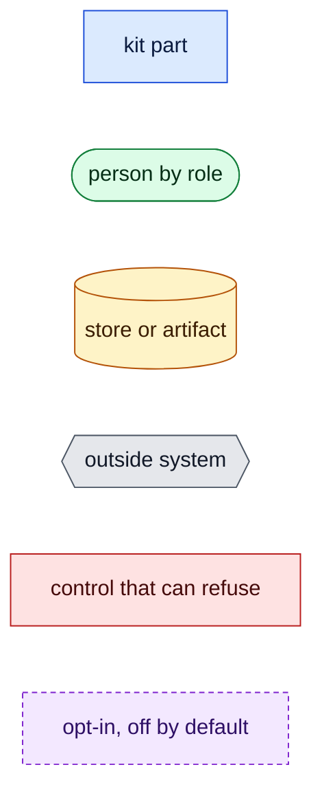
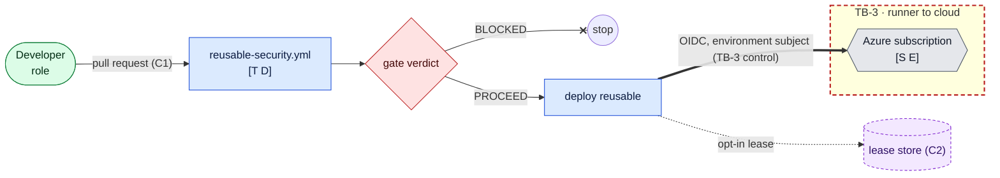

# 00 · Notation and legend

```
Kept:      2026-11-07, drawn against the trunk at c1420ea (fix/normalization-and-discovery).
Audience:  anyone reading docs 01-11 of the architecture suite (INDEX.md lists them in order).
Rule:      every diagram in the suite uses only the marks on this page. A mark not listed here is
           a defect in the diagram; tests/check_mermaid_diagrams.py checks that every diagram parses.
Rendering: Mermaid in fenced blocks; GitHub renders them in place. No image files.
```

## 1 · The levels (C4 style)

The suite follows the C4 model's levels, drawn with Mermaid flowcharts.

| Level | What it shows | Where |
|---|---|---|
| L1 Context | the kit as one box, the people who use it by role, and every outside system | [01_CONTEXT.md](01_CONTEXT.md) |
| L2 Containers | the deployable parts: reusable workflows, composite actions, scripts, templates, the API, overlays | [02_CONTAINERS.md](02_CONTAINERS.md) |
| L3 Components | the jobs and steps inside one container, in run order | `03_COMPONENTS_*.md` |
| Deployment | where each part runs and which identity runs it | [04_DEPLOYMENT_VIEW.md](04_DEPLOYMENT_VIEW.md) |
| Dynamic | one flow in time order (sequence diagrams, state diagrams) | inside the docs that need them |

A **container** in C4 means "a separately run or deployed thing". Here that is a workflow file, a
composite action, a script, or a starter template. It does not mean a Docker container.

## 2 · Shapes

| Mermaid syntax | Shape | Meaning |
|---|---|---|
| `id["text"]` | rectangle | a kit part: workflow, job, action, script, step |
| `id(["text"])` | stadium (pill) | a person, named by **role**, never by name |
| `id[("text")]` | cylinder | a data store or a kept artifact (evidence, ledger, register) |
| `id{{"text"}}` | hexagon | an outside system the kit does not own (GitHub, Azure, a tracker, a scanner feed) |
| `id{"text"}` | diamond | a decision; each way out is labelled |
| `id[/"text"/]` | parallelogram | a trigger or an input (a push, a dispatch, a schedule) |
| `id(("text"))` | circle | the start or end of a flow |

## 3 · Lines

| Mermaid syntax | Meaning |
|---|---|
| `a --> b` | control or data flows from a to b |
| `a -->"label" b` written `a -->\|"label"\| b` | the same, with what flows |
| `a -.-> b` | optional, opt-in, or a read only (nothing is changed) |
| `a ==> b` | **crosses a trust boundary**; the label names the control that holds the crossing |
| `a --x b` | refused: this path is stopped, and the label names the refusal |

## 4 · Colours (classes)

Every class sets its own text colour, so the diagram reads the same in GitHub's light and dark themes.



| Class | Fill | Meaning |
|---|---|---|
| `kit` | blue | code in this repository |
| `person` | green | a person acting in a role |
| `store` | amber | something kept: an artifact, a file on a protected branch, a record |
| `ext` | grey | an outside system |
| `ctrl` | red | a control that can refuse the run, a deploy or a write |
| `optin` | purple, dashed | a part that only runs when someone turns it on |

Copy the six `classDef` lines into a diagram to use the classes. A diagram may use fewer.

## 5 · Trust boundaries

A trust boundary is a line where the level of trust changes: on one side something holds a
privilege, on the other side it does not, or the two sides have different owners.

- A boundary is a Mermaid `subgraph` whose title starts with its id: `subgraph TB3["TB-3 · runner to cloud"]`.
- Its border is drawn red and dashed: `style TB3 stroke:#b91c1c,stroke-width:2px,stroke-dasharray: 6 4`.
- Anything that crosses it uses the thick line `==>`, labelled with the control that holds the crossing.
- The boundary ids TB-1 to TB-14 are defined once, in [05_TRUST_BOUNDARIES.md](05_TRUST_BOUNDARIES.md).
  Every other document uses the same ids.

## 6 · Threat notation (STRIDE)

Each element that a threat can reach carries its STRIDE letters in square brackets on the last line
of its label, for example `"Ticket reconciler<br/>[T I D]"`.

| Letter | Threat | The question it asks |
|---|---|---|
| S | Spoofing | can someone pretend to be this identity or this source? |
| T | Tampering | can someone change this code, data or record without being seen? |
| R | Repudiation | can someone deny they did it, because nothing recorded who? |
| I | Information disclosure | can this leak a secret, a finding or personal data? |
| D | Denial of service | can someone stop this, or make it report clean when it did not run? |
| E | Elevation of privilege | can this give someone more power than they were granted? |

- A threat id is `TH-<boundary>-<n>`, for example `TH-TB3-02`. The full list, with the control,
  the proof file, the residual risk and a suggested mitigation, is [09_THREAT_MODEL.md](09_THREAT_MODEL.md).
- "Denial" in this kit includes the quiet kind: a scanner that did not run and reports zero. The kit
  treats a false clean as a denial of the control, not as a pass.

## 7 · Control state words

The same ladder as [THREAT_MODEL.md](THREAT_MODEL.md) section 0. Nothing is inherited: a state is
what the evidence shows.

| State | Means |
|---|---|
| ABSENT | no control exists |
| DESIGNED | written down, not built |
| BUILT | code exists and its checks pass |
| EXERCISED | it has run on a real host |
| PROVEN | a test shows it refuses what it must, and allows what it must |
| ENFORCED | it has refused a real prohibited operation outside a test |

The suite also says **PROVEN-LOCAL** (a test in `tests/` proves it on a laptop or a hosted self-test)
and **PROVEN-LIVE** (a run against a real cloud or tracker showed it). Most of the kit is PROVEN-LOCAL.

## 8 · Data classification marks

A flow or a store carries its class in round brackets, for example `-->|"findings (C2)"|`.

| Mark | Class | What is in it | Rule |
|---|---|---|---|
| (C0) | public | kit code and documents on the public mirror | may be published |
| (C1) | internal | configuration, variable names, run summaries, the policy register, environment names | stays in the organisation |
| (C2) | confidential | findings, SBOMs, evidence records, tickets, logs, release records | needs the repository's read access; redacted before upload |
| (C3) | secret | tokens, API keys, credentials | **only the name** appears anywhere in the kit; the value lives in a GitHub secret or a protected environment |

Rules that hold at every class:

- No document, diagram, artifact or log in the kit carries a C3 value. Secret names (for example
  `JIRA_TOKEN`) are C1 and may be written.
- A C2 record is redacted before any upload (`scripts/redact_sarif.py`, `scripts/redact_all.sh`;
  proof `tests/check_redaction_parity.py`, `tests/prove_redaction_chain.py`).
- A person is written as a role or a pseudonym (`person:<10 hex>` in evidence), never a name.

## 9 · Citation marks

| Mark | Meaning |
|---|---|
| `KDEC-0nn` | a product decision in `.context/products/secure-cicd-kit/decisions.md` |
| `Proof:` | the test file that shows a control works; it must exist (the diagram check reads every cited path) |
| `Cited:` | the code files a diagram was drawn from |
| `PROPOSED` | a suggestion awaiting the owner; never treated as done |

## 10 · A worked example



Read it as: a developer's pull request runs the security workflow (which can be tampered with or
made to report clean: T, D). The gate decides. BLOCKED stops. PROCEED lets the deploy sign in to
Azure across boundary TB-3, held by the OIDC environment subject. The lease is opt-in.
