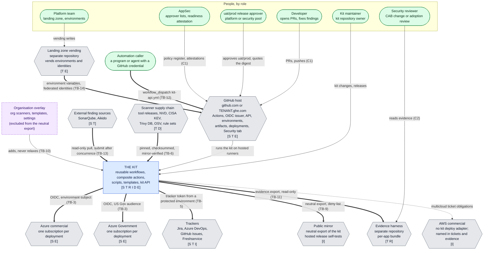

# 01 · Context (C4 level 1)

```
Kept:      2026-11-07, drawn against the trunk at c1420ea. Notation: 00_NOTATION_AND_LEGEND.md.
Audience:  anyone who needs the whole picture before the detail: an owner, a reviewer, a new maintainer.
Rule:      the estate is CONFIGURATION, never a fixed count. How many organisations, tenants,
           subscriptions, repositories or trackers exist is read from the policy register, the
           GitHub environments and the variables each repository is vended. Nothing here assumes a number.
```

## 1 · The kit in one sentence

The kit is a set of GitHub Actions reusable workflows, composite actions and scripts that an
organisation hosts in **one kit repository** and that every **consumer repository** calls, pinned
by commit SHA, to scan, gate, build, deploy, ticket and keep evidence.

## 2 · The context diagram



Cited: `templates/*.yml` (what a consumer calls), `.github/workflows/reusable-*.yml`,
`.github/actions/*/action.yml`, `scripts/kit_api.py`, `scripts/reconcile_tickets.py`,
`scripts/tracker_freshservice.py`, `scripts/external_findings_pull.py`, `scripts/evidence_export.py`,
`scripts/export_for_adoption.py`, `scripts/feed_mirror.py`.

## 3 · The people, by role

| Role | What they do with the kit | Where it is enforced |
|---|---|---|
| Developer | opens pull requests; reads the run summary in plain words; fixes findings; requests exceptions | `reusable-security.yml` gate; `scripts/plain_errors.py` |
| uat/prod release approver | approves a release in the GitHub environment, quoting the digest; is never the requester or the commit's author | `scripts/environment_protection.py`, `scripts/release_gates.py` (KDEC-042, KDEC-034 K-1) |
| AppSec | keeps the approver lists; issues `.kit/zone-readiness.json` outside a landing zone; types a manual-review verdict | `scripts/policy_registration.py`, `scripts/reviewer_signals.py` (KDEC-036) |
| Platform team | runs the landing zone that vends each environment and its federated identity | `docs/architecture/LZ_KIT_HANDOFF_CONTRACT.md` (KDEC-009) |
| Weakening approver | approves a softened control on a registered list, with five fields | `scripts/reviewer_signals.py` (KDEC-036 G2/G3) |
| Ticket fixer and verifier | resolves a ticket; a different person or a rescan verifies it | `scripts/reconcile_tickets.py`, `scripts/ticket_model.py` (KDEC-024) |
| Security reviewer | builds the per-app evidence bundle for a CAB change or adoption review | `scripts/evidence_export.py` (KDEC-039); `docs/security-review/` |
| Kit maintainer | changes the kit; runs the battery; cuts releases; refreshes the feed mirror | `tools/battery.py`, `.github/workflows/self-test.yml` |
| Automation caller | a program or agent that calls the kit API with a GitHub credential (for example a SOAR step) | `scripts/kit_api.py`, `scripts/kit_api_server.py` (KDEC-035) |

Separation of duties across these roles is drawn in [07_IDENTITY_AND_ACCESS.md](07_IDENTITY_AND_ACCESS.md)
section 5 and in [ARCH_02_IDENTITIES_AND_TRUST.md](ARCH_02_IDENTITIES_AND_TRUST.md) section 3.

## 4 · The outside systems

| System | What the kit does with it | Trust boundary |
|---|---|---|
| GitHub host: github.com or a GHE.com tenant (`TENANT.ghe.com`) | runs every workflow; issues OIDC tokens; holds environments, artifacts, deployments, check runs; the job token reaches only the run's own API host (KDEC-027) | TB-1, TB-2, TB-4, TB-7 |
| Azure commercial | deploy targets (App Service, Functions on a custom container, Container Apps, Static Web Apps), the registry, the lease store, the feed mirror | TB-3, TB-8, TB-14 |
| Azure Government | the same, with `KIT_CLOUD=gov`, audience `api://AzureADTokenExchangeUSGov` (ARCH-07) | TB-3 |
| AWS commercial | **no deploy adapter**. The kit knows AWS only as secret patterns (`scripts/redact_sarif.py`), multicloud child obligations on one finding (`scripts/ticket_governance.py`), and resource names in evidence (`scripts/evidence_export.py`). The evidence harness reads AWS; the kit does not | TB-11 |
| Jira | primary tracker (KDEC-004); basic or bearer auth; test tickets on non-default branches | TB-5 |
| Azure DevOps | second tracker; a PAT with work-item read and write in one organisation | TB-5 |
| GitHub Issues | tracker on one repository named by `TICKET_REPO` | TB-5 |
| Freshservice | fourth tracker (KDEC-043); notes instead of tag rewrites | TB-5 |
| Scanner supply chain | gitleaks, detect-secrets, Semgrep, Bandit, CodeQL, Trivy, Checkov, hadolint, OSV-Scanner, Syft, gosec, cppcheck, flawfinder, mobsfscan, Dependency-Check, actionlint, zizmor, shellcheck, PSScriptAnalyzer; data feeds NVD, CISA KEV, Trivy DB, OSV | TB-6 |
| SonarQube, Aikido | read-only pull of their findings into the kit's intake (KDEC-040 item 5) | TB-13 |
| Evidence harness | a separate repository; reads the kit's `evidence.export` into a per-app bundle. The kit holds no evidence-store identity | TB-11 |
| Landing zone vending | a separate repository; writes each environment's `KIT_*` variables and federated identity | TB-14 |
| Public mirror | a neutral export of the kit, used for hosted release self-tests; the private organisation copy is the one consumers call | TB-9 |

## 5 · The organisation overlay

An overlay is a directory under `overlays/<name>/` that adds one organisation's own scanners,
pipeline template, settings and threat notes. Rules (KDEC-003, `THREAT_MODEL.md` section 6):

- An overlay **adds**. It never relaxes a core rule.
- The core never depends on an overlay (`tests/check_custody.py`, the one-way rule).
- The neutral export excludes every overlay that a profile does not name (`scripts/export_for_adoption.py`,
  `scripts/export-profiles/README.md`).
- The core never names an overlay's owner (`tests/check_export_safety.py`).

Where org settings and repository settings disagree, the stricter wins: see
[05_TRUST_BOUNDARIES.md](05_TRUST_BOUNDARIES.md) TB-10.

## 6 · The estate is configuration

| Question | Where the answer lives |
|---|---|
| Which organisations and teams exist, and their rung | the central policy register at the kit pin (`policy/policy-registration.json` in the organisation's kit copy; the neutral kit ships none) |
| Which environments a repository has, and their class | the repository's GitHub environments and `.kit/environments.json` |
| Which cloud and subscription each environment deploys to | the environment's `KIT_CLOUD`, `AZURE_SUBSCRIPTION_ID`, vended by the landing zone |
| Which tracker and project a finding goes to | the register's `ticket_routing` (`scripts/ticket_routing.py`) |
| Which repositories exist, what they already run, and where the kit is on or off | the org survey (`scripts/kit_survey.py`, KDEC-045 PROPOSED), the per-run survey (`.github/actions/discover` part `survey`) and the census (`scripts/inventory_consumers.py`) |
| Whether the organisation is set up for the kit | the org setup check (`scripts/kit_org_init.py`) |

## 7 · What is not covered at this commit

- No AWS deploy adapter and no AWS federated sign-in.
- A live Azure Government sign-in has not run (ARCH-07, UNVERIFIED).
- Code-packaged Functions, AKS and VMs have no adapter; they are named `NO_KIT_ADAPTER:<kind>` on every security run.
- The kit API has not had a hosted armed call per operation (ARCH-04 section 3).
