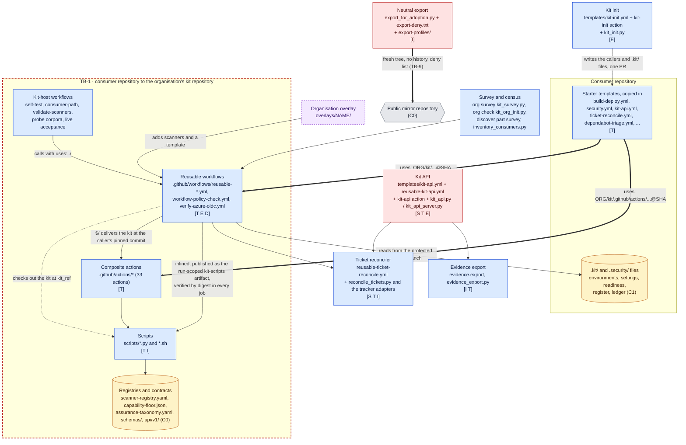

# 02 · Containers (C4 level 2)

```
Kept:      2026-11-07, drawn against the trunk at c1420ea. Notation: 00_NOTATION_AND_LEGEND.md.
Audience:  whoever changes the kit, or wires a repository to it, and needs to know which file runs where.
Rule:      a "container" here is a separately run thing: a starter template, a reusable workflow,
           a composite action, a script, a registry. Every file is listed one by one in
           code-walkthrough/ (INDEX.md).
```

## 1 · The containers and how they call each other



## 2 · How kit code reaches a consumer's runner

A reusable workflow called from another repository resolves `uses: ./` against the **caller's**
checkout, so the kit's own `scripts/` are not there. The kit uses four ways to deliver its code,
each verified:

| Way | Used by | What holds it | Proof |
|---|---|---|---|
| **Inline and publish.** The canonical script is written into the workflow between generated markers, published once per run as the `kit-scripts` artifact, and every job checks it against the pinned digest before use | `reusable-security.yml` (part 1 of the `plan` job) | `scripts/inline_normalizer.py --check` (no drift, no duplicate); the "Verify the kit scripts against their pinned digest" step | `tests/prove_kit_script_digests.py`, `tests/prove_plan_job.py` |
| **Inline per step.** The deploy contract scripts are written out in the deploy job's first step | the three deploy reusables | `scripts/inline_deploy_scripts.py --check` (drift check in self-test) | `tests/prove_deploy_inputs_via_env.py` (values reach the steps as data) |
| **`$/`.** Delivers the whole kit at the caller's pinned commit; a composite is called as `uses: $/.github/actions/NAME` | discover, resolve, the scanners, the report, the gate's composites, the deploys' composites | the pin itself; needs github.com-style hosting and runner 2.336.0 or later (no GitHub Enterprise Server) | `tests/test_discovery.py`, `tests/prove_composite_move_equivalence.py` |
| **Explicit kit checkout.** `actions/checkout` of `kit_repository` at `kit_ref` | ticket reconcile, exception due, rollback sequence | the caller passes the same SHA as its `uses:` pin | `tests/prove_ticket_reconcile_workflow.py` |

## 3 · The containers, one by one

### 3.1 Starter templates (`templates/`)

Files a consumer copies into `.github/workflows/`, replacing `YOUR_ORG` and the placeholder SHA.
Each grants **exactly** the permissions the called workflow's jobs request (`tests/check_caller_permissions.py`).

| Template | Calls | When it runs |
|---|---|---|
| `templates/build-deploy.yml` | security, policy, build, verdict, deploy dev/test, promote, break-glass scan and tickets | push to main, PR, dispatch, called by the kit API |
| `templates/build-deploy-static.yml` | the same for a static site (package, attest, Static Web Apps) | push to main, PR, dispatch |
| `templates/security.yml` | `reusable-security.yml` only (scan-only repositories) | push, PR, dispatch |
| `templates/policy.yml` | `workflow-policy-check.yml` | push, PR, dispatch |
| `templates/ticket-reconcile.yml` | security, then tickets, then the ledger proposal; a scheduled clock | push, PR, schedule, dispatch |
| `templates/kit-api.yml` | the kit API phases, scan, deploy (its own `build-deploy.yml`) | dispatch, repository_dispatch |
| `templates/deployed-scan.yml` | the daily scan of what serves, then tickets | schedule, dispatch |
| `templates/dependabot-triage.yml` | triage on Dependabot PRs; keep-current on push and schedule | pull_request_target, push, schedule |
| `templates/dependabot-config-check.yml` | the manifest-coverage check | PR, dispatch |
| `templates/exception-due.yml` | list and resurface exceptions coming due | schedule, dispatch |
| `templates/external-findings.yml` | SonarQube and Aikido pull; submit after review | schedule, dispatch |
| `templates/feed-mirror-refresh.yml` | refresh the organisation's feed mirror (kit host only) | schedule, dispatch |
| `templates/nvd-cve.yml` | NVD and Dependency-Check scan | PR, schedule, dispatch |
| `templates/rollback-sequence.yml` | several deployments reversed newest first | dispatch |
| `templates/kit-init.yml` | kit init as a button | dispatch |
| `templates/kit-survey.yml` | the org survey and the one-time org setup check, read-only (KDEC-045 PROPOSED) | dispatch |

### 3.2 Reusable workflows (`.github/workflows/`)

| Workflow | What it is | Jobs |
|---|---|---|
| `reusable-security.yml` | the scan and the gate: the single enforcement point | plan, secret-scan, code-quality, sast-semgrep, sast-bandit, codeql, deps-scan, iac-scan, sast-dotnet, sast-java, sast-mobile, sast-go, sast-cpp, image-scan, malicious-deps, sbom, security-gate |
| `workflow-policy-check.yml` | the consumer's own workflows against supply-chain rules | policy-check |
| `reusable-build-docker.yml` | build once, scan before push, SBOM, push, attest | build, attest |
| `reusable-deploy-containerapp.yml`, `reusable-deploy-appservice.yml`, `reusable-deploy-staticwebapp.yml` | one deploy each; every refusal before the cloud login | deploy |
| `reusable-deployed-scan.yml` | daily reconcile and re-scan of what serves | scan, report |
| `reusable-rollback-sequence.yml` | sequential rollback with a test period per step | rollback |
| `reusable-ticket-reconcile.yml` | findings to tickets, the deferral clock | guard, sweep, resurface, reconcile |
| `reusable-propose-ledger.yml` | the only writer of the baseline ledger, as a pull request | propose-ledger |
| `reusable-ticket-reference.yml` | a PR must carry a tracker reference | validate-reference |
| `reusable-exception-due.yml` | exceptions coming due, resurfaced on their ticket | list, resurface |
| `reusable-kit-api.yml` | the API's run side | intake, tickets, finish |
| `reusable-external-findings.yml` | SonarQube/Aikido pull and submit | pull, submit |
| `reusable-dependabot-triage.yml` | one decision per Dependabot PR | classify, auto-merge, human-review, close |
| `reusable-dependabot-keep-current.yml` | ask behind Dependabot PRs to rebase | keep-current |
| `reusable-dependabot-config-check.yml` | every manifest has a Dependabot entry | check |
| `reusable-nvd-cve.yml` | NVD Dependency-Check and Trivy, SBOM and image re-scan | nvd-cve-scan |
| `reusable-feed-mirror-refresh.yml` | refresh NVD, KEV, Trivy DB, OSV mirrors and scanner images | refresh, images |
| `verify-azure-oidc.yml` | prove a federated identity's boundary, read-only | verify |
| `reusable-kit-survey.yml` | the org survey and org setup check, GET only; reports kept as the `kit-survey` artifact | one job |

Kit-host-only workflows (they run in the kit repository, never in a consumer): `self-test.yml`,
`consumer-path-test.yml`, `consumer-path-negative.yml`, `validate-scanners.yml`,
`probe-scanner-corpora.yml`, `live-deploy-acceptance.yml`, and the kit's own callers `kit-survey.yml`,
`dependabot-triage.yml`, `dependabot-config-check.yml`, `external-findings.yml`, `nvd-cve.yml`.

### 3.3 Composite actions (`.github/actions/`)

Grouped by purpose; [code-walkthrough/github-actions.md](code-walkthrough/github-actions.md) lists each.

| Purpose | Actions |
|---|---|
| plan | `discover` (survey, platform), `resolve`, `determine-changes` |
| scanners | `secret-scan`, `deps-scan`, `iac-scan`, `sast-dotnet`, `sast-java`, `sast-mobile`, `sast-cpp`, `deployed-scan` |
| gate | `scan-report`, `capability-floor`, `resolve-policy`, `known-exploited`, `run-record`, `reviewer-signals`, `plain-errors` |
| feeds | `feed-mirror`, `feed-mirror-refresh` |
| build and deploy | `docker-build-push`, `render-version-metadata`, `verify-attestation`, `static-site-package`, `target-lease`, `azure-login-oidc` |
| ticketing and API | `propose-ledger`, `kit-api` |
| adoption | `kit-init` |
| tool setup | `setup-python`, `setup-node`, `setup-terraform`, `selftest-tools` |

### 3.4 Scripts (`scripts/`)

Standard-library Python where it can be (some read YAML with PyYAML). Each script is one concern and
most carry `--self-test`. The large ones:

| Script | Concern |
|---|---|
| `scripts/scan_report.py` | turns scanner SARIF into the five-section report and `findings.json`; never a fabricated zero |
| `scripts/policy_registration.py` | reads the policy register (central and repository) and resolves the rung, the controls and the approver lists |
| `scripts/reconcile_tickets.py` | findings to tickets; lookup always before creation |
| `scripts/deploy_contract.py`, `scripts/promotion.py`, `scripts/release_gates.py`, `scripts/environment_protection.py` | the deploy contract, the promotion gate, the release preconditions, the environment read-back |
| `scripts/kit_api.py`, `scripts/kit_api_server.py` | the API's client and run side |
| `scripts/evidence_export.py` | the kit's half of the per-app evidence bundle |
| `scripts/kit_init.py` | wire a repository in one command |
| `scripts/export_for_adoption.py` | the neutral export, a gate |

### 3.5 Registries and contracts (repository root, `schemas/`, `api/v1/`)

| File | Holds | Read by |
|---|---|---|
| `scanner-registry.yaml` | every scanner, its job, its capability | `tests/check_scanner_registry.py`, the report |
| `capability-floor.json` | what the gate must expect whatever the registry says; shrinks only by tombstone | `scripts/capability_floor.py` |
| `assurance-taxonomy.yaml` | every state word the kit may emit | `scripts/reconcile_taxonomy.py`, `scripts/plain_errors.py` |
| `rollback-resource-classes.yaml` | how each resource class may be reversed | `scripts/rollback_dependencies.py` |
| `schemas/*.json` | run record, dispositions, promotion record, rollback sequence, policy register | the scripts that write them |
| `api/v1/` | the API contract: request, result, refusals, one schema per operation | `scripts/kit_api.py` |

### 3.6 The rest

| Container | Path | Purpose |
|---|---|---|
| Overlays | `overlays/NAME/` | one organisation's additions; each carries its own `CODE_WALKTHROUGH.md` |
| Developer safety | `developer-safety/` | branch-protection profiles, push ruleset, pre-commit hooks, gitignore baseline, CODEOWNERS examples |
| Feed-mirror infrastructure | `infra/feed-mirrors/` | Terraform for the private storage account that holds the mirrors |
| Battery | `tools/battery.py` and its shell twins | runs locally what the required self-test jobs run |
| Tests | `tests/` | checks (`check_*`), proofs (`prove_*`), stand-ins (`_*`), fixtures and corpora |

## 4 · The public mirror's role

- The organisation's **private** kit copy is what consumers call.
- The **public mirror** is a neutral export of the private kit: a fresh tree, no history, every
  deny-list pattern refused (`scripts/export_for_adoption.py`; TB-9).
- Hosted release self-tests run on the public mirror, where features a private plan lacks
  (for example attestations) are available.
- Nothing flows back from the public mirror into the private kit automatically.

## 5 · What is proven

`tests/check_caller_permissions.py` (callers grant exactly what is requested),
`tests/check_action_pins.py` (every remote action pinned by SHA), `tests/check_workflow_size.py`
(no workflow over GitHub's start limit), `tests/prove_kit_script_digests.py` (the inline scripts are
the pinned ones), `tests/check_export_safety.py` and `tests/prove_export_scope.py` (the export).
