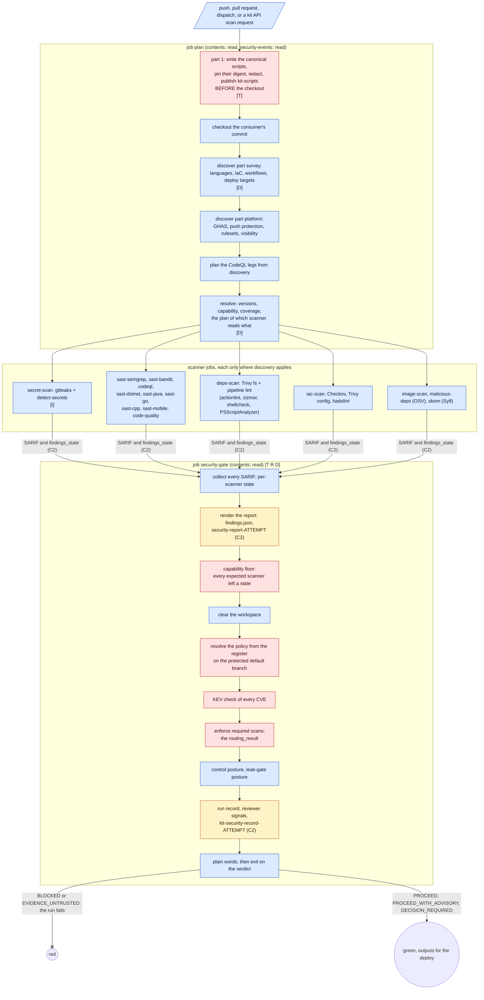

# 03a · Components: the security run and its gate

```
Kept:      2026-11-07, drawn against the trunk at c1420ea. Notation: 00_NOTATION_AND_LEGEND.md.
Container: .github/workflows/reusable-security.yml (called by templates/security.yml,
           templates/build-deploy.yml job `security`, templates/kit-api.yml job `scan`).
Design:    10a_DESIGN_SECURITY_GATE.md. Ordering rules: PIPELINE_ORDERING_AND_SCAN_VALIDITY.md.
```

## 1 · The jobs, in run order



Cited: the job and step names of `.github/workflows/reusable-security.yml`; `.github/actions/discover/action.yml`,
`.github/actions/resolve/action.yml`, `.github/actions/scan-report/action.yml`,
`.github/actions/capability-floor/action.yml`, `.github/actions/resolve-policy/action.yml`,
`.github/actions/known-exploited/action.yml`, `.github/actions/run-record/action.yml`,
`.github/actions/reviewer-signals/action.yml`, `.github/actions/plain-errors/action.yml`.

## 2 · The components and what each holds

| Component | Code | Holds | Proof |
|---|---|---|---|
| kit-scripts part | `plan` job part 1; `scripts/inline_normalizer.py` | the scripts are the pinned ones; written before consumer content is in the workspace | `tests/prove_plan_job.py`, `tests/prove_kit_script_digests.py` |
| survey | `.github/actions/discover` part `survey` | what is in scope; an unreadable root is named, never "nothing there" | `tests/test_discovery.py`, `tests/prove_discovery_depth.py` |
| platform | `.github/actions/discover` part `platform` | GHAS, push protection, rulesets; `UNKNOWN` is not `false` | `tests/prove_platform_discovery.py` |
| resolve | `.github/actions/resolve` | which carried scanner can read each target (KDEC-010); version gaps | `tests/test_resolve.py`, `tests/prove_capability_selection.py` |
| scanner jobs | `reusable-security.yml` jobs and the scanner composites | each reports `findings_state`; a job fails only when it could not scan | `tests/prove_scanners_survive_enforce.py`, `tests/prove_hollow_scan.py` |
| report | `scripts/scan_report.py` via `.github/actions/scan-report` | five sections; zero only when a scanner looked | `tests/prove_report_and_gate.py`, `tests/prove_report_counts_findings.py` |
| capability floor | `scripts/capability_floor.py`, `capability-floor.json` | a scanner removed from the registry is still expected | `tests/prove_capability_floor.py` |
| policy | `scripts/policy_registration.py` via `resolve-policy` | rung and per-control minimums from the protected default branch, never the PR tree | `tests/prove_gate_reads_rung.py`, `tests/prove_policy_registration.py` |
| KEV | `scripts/known_exploited.py` | a CVE on CISA KEV blocks at every rung; an unreadable catalog is never a pass | `tests/prove_known_exploited.py` |
| enforce | the `gate` step | the precedence maximum of every control's route | `tests/prove_gate_routing.py`, `tests/prove_bootstrap_failure.py`, `tests/prove_secrets_always_block.py` |
| posture | control and leak-gate posture steps | required, executed, unavailable, reduced, skipped, and who decided | `tests/prove_leak_gate_posture.py` |
| run record | `scripts/run_record.py` | the record validates against `schemas/assurance-result.schema.json` or is not emitted | `tests/prove_gate_run_record.py` |
| reviewer signals | `scripts/reviewer_signals.py` | weakening authority, verdict provenance, watermark, the security record | `tests/prove_reviewer_signals.py` |
| plain words | `scripts/plain_errors.py` | every refusal said in a sentence first, the state name after | `tests/prove_plain_errors.py` |

## 3 · The verdict words

The gate emits one `routing_result`, the precedence maximum across controls:

`BLOCKED` > `EVIDENCE_UNTRUSTED` > `DECISION_REQUIRED` > `PROCEED_WITH_ADVISORY` > `PROCEED`

- The rung (crawl, walk, run) sets the weakest result each control may contribute
  (`scripts/rung_ladder.py`; `RUNG_DERIVATION_TABLE.md`).
- Secrets block at every rung. A known-exploited CVE blocks at every rung (KDEC-022). A known-malicious
  package blocks in every mode.
- At a production tier (uat, prod) `EVIDENCE_UNTRUSTED` stops the run; below it warns
  (`scripts/enforcement_axes.py`).
- An absent or unrecognised verdict is `EVIDENCE_UNTRUSTED`, never a pass (the template's `verdict` job).

## 4 · Outputs the rest of the kit reads

The workflow declares 47 outputs. The ones other containers depend on:

| Output | Read by |
|---|---|
| `routing_result`, `advisory_causes`, `controls_unavailable` | the template's `verdict` job; every deploy |
| `deploy_approval`, `max_exception_renewals` | every deploy (approver groups, renewal cap) |
| `evidence_artifact`, `security_record` | the ticket reconciler, the kit API, `evidence.export` |
| `kev_state`, `kev_verdict` | the security record; the promotion re-check |
| `rung_effective`, `policy_source`, `environment_tier` | the reviewer signals; the evidence |

## 5 · Trust and threat notes

- **TB-1** (consumer to kit): caller inputs reach every script as `env:` data, never as script text
  (`tests/lint_injection.py`, `tests/check_expression_length.py`).
- **TB-2** (PR content): on a pull request the policy is read from the protected default branch, so a
  PR cannot choose its own rung (`tests/prove_gate_reads_rung.py`).
- **TB-6** (scanner supply chain): every tool is pinned by version and checksum
  (`tests/check_pinned_installs.py`); the Trivy DB, OSV and KEV come from the organisation mirror only when
  current and intact (`tests/prove_feed_mirror.py`).
- **D (the quiet denial)**: a skipped or crashed scanner is `NOT_ESTABLISHED`, never zero
  (`tests/prove_hollow_scan.py`, `tests/prove_scan_status_zero.py`).
- Threat entries: [09_THREAT_MODEL.md](09_THREAT_MODEL.md) TH-TB1-*, TH-TB2-*, TH-TB6-*.
