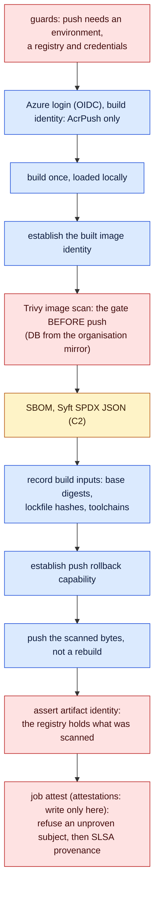

# 03b · Components: build, verdict, deploy and promotion

```
Kept:      2026-11-07, drawn against the trunk at c1420ea. Notation: 00_NOTATION_AND_LEGEND.md.
Containers: templates/build-deploy.yml (and build-deploy-static.yml), reusable-build-docker.yml,
            reusable-deploy-containerapp.yml, reusable-deploy-appservice.yml,
            reusable-deploy-staticwebapp.yml, reusable-deployed-scan.yml, reusable-rollback-sequence.yml.
Design:    10b_DESIGN_BUILD_AND_DEPLOY.md. End to end: ARCH_01_PIPELINE_END_TO_END.md.
```

## 1 · The template's jobs (one consumer repository)

```mermaid
flowchart LR
  PUSH[/"push to main"/]:::kit
  DISP[/"dispatch: promote_from_run_id, environment uat or prod"/]:::kit
  SEC["security<br/>reusable-security.yml"]:::ctrl
  POL["policy<br/>workflow-policy-check.yml"]:::ctrl
  BLD["build<br/>reusable-build-docker.yml<br/>environment: build<br/>[S T]"]:::kit
  VER["verdict<br/>V1 attestation, decide, stamp<br/>[T]"]:::ctrl
  DDEV["deploy-dev<br/>environment: dev"]:::kit
  DTST["deploy-test<br/>environment: test"]:::kit
  PS["promotion-source<br/>reads kit-promotion-record-ENV<br/>(actions: read, no identity)"]:::kit
  PRO["promote<br/>environment: uat or prod<br/>required reviewers<br/>[S E]"]:::ctrl
  BGS["break-glass-scan<br/>reusable-deployed-scan.yml"]:::optin
  BGT["break-glass-tickets<br/>reusable-ticket-reconcile.yml"]:::optin
  REC[("kit-promotion-record-ENV,<br/>kit-release-record deployment (C2)")]:::store
  PUSH --> SEC & POL
  SEC & POL --> BLD --> VER
  VER -->|"deploy_allowed"| DDEV & DTST
  VER --x|"not allowed: the job fails, visibly"| NO(("refused"))
  DDEV & DTST --> REC
  DISP --> PS --> PRO
  REC -.->|"the predecessor's record for this exact digest"| PS
  PRO --> REC
  PRO -->|"release_path break-glass"| BGS --> BGT
  classDef kit fill:#dbeafe,stroke:#1d4ed8,color:#0b1b3f
  classDef store fill:#fef3c7,stroke:#b45309,color:#3b1d02
  classDef ctrl fill:#fee2e2,stroke:#b91c1c,color:#450a0a
  classDef optin fill:#f3e8ff,stroke:#7e22ce,color:#2e1065,stroke-dasharray: 4 3
```



Cited: `templates/build-deploy.yml` jobs `security`, `policy`, `build`, `verdict`, `deploy`,
`deploy-dev`, `deploy-test`, `promotion-source`, `promote`, `break-glass-scan`, `break-glass-tickets`.

- **Build once, promote the same digest** (KDEC-029). uat and prod are never built for.
- **The verdict job decides from outputs, not from job success.** It ranks the security and build
  `routing_result`, forces `EVIDENCE_UNTRUSTED` when `artifact_identity` is not
  `REGISTRY_IDENTITY_PROVEN`, and folds in V1. A requested deploy that is refused fails the job
  (`tests/prove_template_branches_on_verdict.py`).
- **Two verdicts leave it**: `routing_result` (with V1, decides `deploy_allowed`) and
  `deploy_routing_result` (without V1, handed to the deploy, which re-runs V1 itself before login).

## 2 · The build job (`reusable-build-docker.yml`)



Proof: `tests/check_artifact_identity.py`, `tests/prove_build_push_round_trip.py`,
`tests/prove_build_inputs_recorded.py`, `tests/prove_attest_job_isolated.py`, `tests/prove_build_routing.py`,
`tests/check_buildonly_contract.py` (a build-only run needs no credential).

## 3 · Inside one deploy job: every refusal before the cloud login

All three deploy reusables share this order. The step names are the Container Apps adapter's.

```mermaid
flowchart TB
  subgraph BEFORE["before the Azure login: refusing costs nothing"]
    D1["materialise the deploy contract scripts"]:::kit
    D2["bind the tier and target to the GitHub environment"]:::ctrl
    D3["zone readiness source: the landing zone's hand-off,<br/>or AppSec's attestation"]:::ctrl
    D4["platform stop and zone readiness"]:::ctrl
    D5["environment protection read back:<br/>reviewers, self-review prevented, pools"]:::ctrl
    D6["gate verdict"]:::ctrl
    D7["digest only: refuse a mutable tag"]:::ctrl
    D8["V1: the build-provenance attestation"]:::ctrl
    D9["rollback-of-target check"]:::ctrl
    D10["promotion preflight and gate:<br/>source record, predecessor, revocations,<br/>SBOM re-scan, KEV re-check"]:::ctrl
    D11["release approval: not the requester,<br/>not the author, quotes the digest"]:::ctrl
    D12["reviewer signals: verdict provenance,<br/>weakening authority, tier, readiness source"]:::ctrl
  end
  subgraph TB3["TB-3 · runner to cloud"]
    L["Azure login, OIDC, the environment's deploy identity<br/>[S E]"]:::kit
  end
  subgraph AFTER["after the login"]
    M1["target lease acquire (opt-in)"]:::optin
    M2["capture pre-change state; establish rollback"]:::kit
    M3["field ownership at the seam (opt-in)"]:::optin
    M4["deploy by digest; verify healthy before traffic"]:::kit
    M5["move traffic; verify the consumer path"]:::kit
    M6["reverse this run's changes when unhealthy"]:::ctrl
    M7["stamp provenance; purge the app's own edge endpoint"]:::kit
    M8["end-to-end test period; DAST, never prod; posture"]:::kit
    M9["outcome, control posture, promotion record,<br/>release record, run record (C2)"]:::store
  end
  D1 --> D2 --> D3 --> D4 --> D5 --> D6 --> D7 --> D8 --> D9 --> D10 --> D11 --> D12
  D12 ==>|"every gate held"| L
  L --> M1 --> M2 --> M3 --> M4 --> M5 --> M7 --> M8 --> M9
  M4 -->|"unhealthy"| M6 --> M9
  style TB3 stroke:#b91c1c,stroke-width:2px,stroke-dasharray: 6 4
  classDef kit fill:#dbeafe,stroke:#1d4ed8,color:#0b1b3f
  classDef store fill:#fef3c7,stroke:#b45309,color:#3b1d02
  classDef ctrl fill:#fee2e2,stroke:#b91c1c,color:#450a0a
  classDef optin fill:#f3e8ff,stroke:#7e22ce,color:#2e1065,stroke-dasharray: 4 3
```



## 4 · The components and what each holds

| Component | Code | Holds | Proof |
|---|---|---|---|
| bind | the "Bind the tier and target" step (inline bash in each deploy reusable) | tier, resource group, app, registry, repository and cloud equal the environment's vended values; an empty input is filled from the environment | `tests/prove_deploy_environment_binding.py` |
| readiness, stop | `scripts/release_gates.py` | `KIT_RELEASE_BLOCK` not `none` refuses at every tier; readiness at uat/prod | `tests/prove_release_gates.py`, `tests/prove_handoff_extended.py` |
| protection read-back | `scripts/environment_protection.py` | uat/prod gated by reviewers from outside the app team (KDEC-042) | `tests/prove_uat_prod_gating.py`, `tests/prove_deploy_environment_protection.py` |
| verdict | the gate-verdict step | only `PROCEED` or `PROCEED_WITH_ADVISORY` deploy | `tests/prove_deploy_gate.py` |
| digest | the digest step | a full `sha256:` digest, read as data | `tests/prove_deploy_inputs_via_env.py` |
| V1 | `.github/actions/verify-attestation` (inlined into the deploy by `scripts/inline_deploy_scripts.py`) | the digest was signed by the kit's build workflow | `tests/prove_deploy_attestation.py`, `tests/prove_attestation_verify.py` |
| rollback marker | `scripts/rollback_hold.py` `check` | an incoming deploy after a rollback of its target is dependency-checked (KDEC-023) | `tests/prove_rollback_dependencies.py` D7/D8 |
| promotion gate | `scripts/promotion.py` | the predecessor verified this exact digest within 14 days, nothing revoked | `tests/prove_promotion.py` |
| release approval | `scripts/release_gates.py` | approver is not the requester or the author, and quotes the digest | `tests/prove_release_gates.py` |
| reviewer signals | `scripts/reviewer_signals.py` | a typed verdict is refused at uat/prod unless an attributed manual review | `tests/prove_reviewer_signals.py` |
| lease and seam | `scripts/target_lease.py`, `.github/actions/target-lease` | one writer per target across repositories (opt-in) | `tests/prove_target_lease.py`, `tests/prove_target_lease_crossrepo.py`, `tests/prove_seam_setting_ownership.py` |
| capture, mutate, verify, reverse | `scripts/deploy_contract.py` | NOW SERVING is read back, never echoed | `tests/prove_deploy_now_serving.py`, `tests/prove_deploy_outcome.py` |
| static site | `scripts/static_site_contract.py` | the artefact identity is the site's tree digest | `tests/prove_deploy_staticwebapp.py` |
| release record | `scripts/reviewer_signals.py` | a GitHub deployment with task `kit-release-record` outlives artifacts | `tests/prove_release_record_store.py` |

## 5 · After the release

| Container | What it does | Proof |
|---|---|---|
| `reusable-deployed-scan.yml` | daily: reconcile what serves, report artifact drift and security drift apart, KEV re-check; never rolls back | `tests/prove_deployed_scan_lz_vocabulary.py`, `tests/prove_promotion.py` |
| `reusable-rollback-sequence.yml` | several deployments reversed newest first, a test period after each step | `tests/prove_rollback_sequence.py`, `tests/prove_seam_app_rollback_refuses_shared_entry.py` |

## 6 · Trust and threat notes

- TB-3 (runner to cloud), TB-7 (environment approval gate), TB-8 (artifact identity) and TB-14 (shared
  target) are all crossed in one deploy job; see [05_TRUST_BOUNDARIES.md](05_TRUST_BOUNDARIES.md).
- A run that passes is not proof of a governed deployment when the opt-in controls are off: no lease,
  no release block, no edge purge (ARCH-01 section 2).
- Threat entries: [09_THREAT_MODEL.md](09_THREAT_MODEL.md) TH-TB3-*, TH-TB7-*, TH-TB8-*, TH-TB14-*.

## Deployment protection

Moved here from the comments of `.github/workflows/reusable-deploy-staticwebapp.yml` on 2026-11-13 (integration of the round-5 lanes) to keep that file under the `tests/check_workflow_size.py` fail threshold; the workflow keeps a one-line pointer. The same text still sits in the comments of the App Service and Container App deploy reusables (and, for the concurrency note, of `reusable-build-docker.yml`).

```text
Owner, 2026-10-22: uat and prod need ONE approver from a named reviewer group who is NOT
the deploying developer -- the GitHub environment's required reviewers, self-review
prevented. The kit cannot set that; it READS it back (read-only environments API) and,
at uat and prod, refuses when the policy demands it and the environment lacks it, or when
it cannot be read (NOT_ESTABLISHED is not a pass). Below uat it is recorded and warned.
The body is identical in both deploy reusables. tests/prove_deploy_environment_protection.py.
KDEC-042 (owner 2026-11-06, "never a prod deployment without a human approval"): the environment is
CLASSED first (the strongest of the bound tier, the caller's .kit/environments.json and the name;
an unclassed or empty name is refused at every tier), and at uat and prod it must exist, name
reviewers, prevent self-review, include a platform or security pool member when pools are named
(vars.KIT_APPROVER_POOLS, else .kit/settings.json) and not be the app team alone (vars.KIT_APP_TEAM,
else .kit/settings.json). The API host is the run's own (GITHUB_API_URL; GHE.com, KDEC-027).
tests/prove_uat_prod_gating.py.
```
