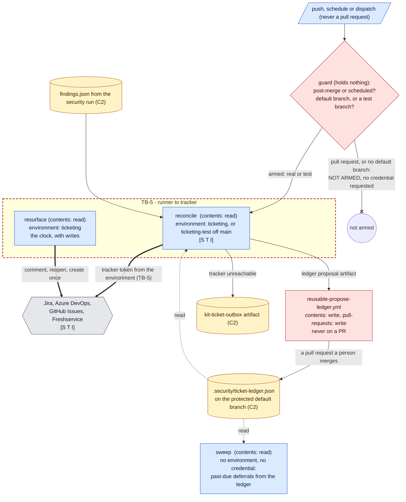
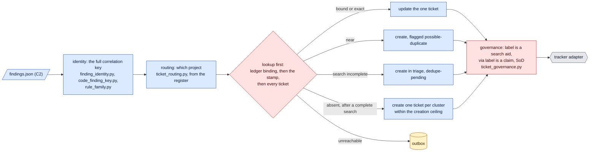

# 03c · Components: ticketing

```
Kept:      2026-11-07, drawn against the trunk at c1420ea. Notation: 00_NOTATION_AND_LEGEND.md.
Containers: reusable-ticket-reconcile.yml, reusable-propose-ledger.yml, reusable-exception-due.yml,
            reusable-ticket-reference.yml, the kit API's tickets job (03e).
Design:    10c_DESIGN_TICKETING.md. Contracts: TICKETING_CONTRACT.md, TICKETING_BACKENDS.md,
           JIRA_AUTH_AND_ROUTING.md. The flow from finding to closed ticket: ARCH_03_TICKETING.md.
```

## 1 · The jobs of the ticket reconciler



Cited: `.github/workflows/reusable-ticket-reconcile.yml` jobs `guard`, `sweep`, `resurface`,
`reconcile`; `templates/ticket-reconcile.yml` jobs `security`, `tickets`, `ledger`, `ticket-clock`;
`.github/workflows/reusable-propose-ledger.yml`.

- **Ticketing never runs in a pull request.** The guard decides from the event and the ref alone and
  holds no credential (`tests/prove_ticket_reconcile_workflow.py`; self-test job
  `ticket-reconcile-refuses-pr`).
- **The branch chooses test or real** (KDEC-028): the default branch writes real tickets in
  `ticketing`; any other branch (dispatch or push, never schedule) writes `[TEST]` tickets in
  `ticketing-test`, and `JIRA_REAL_PROJECTS` refuses a test run aimed at a real project.
- **The sweep needs no tracker** and so runs with no environment and no secret.
- **The ledger is written only by a pull request** that a person merges (`scripts/propose_ledger.py`;
  self-test job `ledger-proposal-refuses-pr`).

## 2 · Inside the reconcile step



## 3 · The components and what each holds

| Component | Code | Holds | Proof |
|---|---|---|---|
| reconciler | `scripts/reconcile_tickets.py` | a lookup always precedes a creation; the four lookup states never collapse | `tests/prove_ticket_lifecycle.py`, `tests/prove_ticket_idempotency.py` |
| parent and child model | `scripts/ticket_model.py` | a parent cannot close over open children; a deferral needs a reason | `tests/prove_ticket_lifecycle.py` |
| finding identity | `scripts/finding_identity.py`, `scripts/code_finding_key.py`, `scripts/rule_family.py`, `scripts/finding_ids.py` | durable keys that survive a scanner upgrade; SAST and secret keys (KDEC-038) | `tests/prove_identity_durability.py`, `tests/prove_rule_family_upgrade.py`, `tests/prove_sast_secret_tickets.py` |
| routing | `scripts/ticket_routing.py` | first matching rule wins; an unrouted finding is a triage state (KDEC-043) | `tests/prove_jira_auth_and_routing.py` |
| governance | `scripts/ticket_governance.py` | the full key is the only identity; a `via` label is a claim; multicloud children | `tests/prove_ticket_governance.py` |
| intake | `scripts/ticket_intake.py` | every ticket, manual ones too, is searched before a create | `tests/prove_ticket_intake_v2.py` |
| Freshservice adapter | `scripts/tracker_freshservice.py` | notes, not tag rewrites, so a person's tags are never lost | `tests/prove_freshservice_tracker.py` |
| backends | the Jira, Azure DevOps and GitHub Issues adapters inside `scripts/reconcile_tickets.py` | one contract for four trackers | `tests/prove_ticket_backends.py` |
| ledger proposal | `scripts/propose_ledger.py` via `.github/actions/propose-ledger` | only a PR, never on a PR run, CODEOWNERS covers the path | `tests/prove_propose_ledger.py`, `tests/prove_propose_ledger_establishment.py`, `tests/prove_propose_ledger_ticket_ledger.py` |
| exceptions coming due | `scripts/exception_due.py`, `scripts/exception_history.py` | an exception resurfaces with its history; endless exceptions show | `tests/prove_exception_due.py`, `tests/prove_exception_history_derived.py` |
| ticket reference gate | `reusable-ticket-reference.yml`, `scripts/ticket_reference.py` | a PR carries a tracker reference; enforcement is off and has no range by default | `tests/prove_ticket_reference_gate.py` |
| SLA | `scripts/remediation_sla.py` | the remediation clock per severity | `tests/prove_remediation_sla.py` |

## 4 · The trackers

| Tracker | Credential (name only) | Scope of the credential | Where it lives |
|---|---|---|---|
| Jira | `JIRA_TOKEN` (+ `JIRA_EMAIL` for basic auth; `JIRA_AUTH_MODE=bearer` for a service-account token); optional `JIRA_HOST` as a secret | the projects the routing names | the `ticketing` / `ticketing-test` environments |
| Azure DevOps | `AZDO_PAT` | work items read and write, one organisation | the same |
| GitHub Issues | `GH_TICKET_TOKEN` | issues read and write on the one repository `TICKET_REPO` names | the same |
| Freshservice | `FRESHSERVICE_API_KEY` | the workspace `FRESHSERVICE_WORKSPACE_ID` names | the same |

## 5 · Trust and threat notes

- TB-5 (runner to tracker): one job holds the credential, from a protected environment, with
  `contents: read` and a timeout; finding text reaches the tracker as data through `env:`.
- TB-2 (PR content): the guard refuses every pull-request event before any credential is requested.
- Repudiation: the stamp and the ledger record which run wrote which ticket; provenance is the
  authenticated identity compared with the tracker's own record (KDEC-043).
- Threat entries: [09_THREAT_MODEL.md](09_THREAT_MODEL.md) TH-TB5-*.
