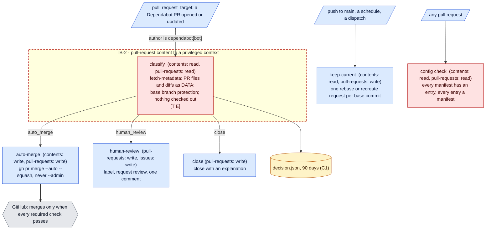

# 03d · Components: Dependabot triage, keep-current and the config check

```
Kept:      2026-11-07, drawn against the trunk at c1420ea. Notation: 00_NOTATION_AND_LEGEND.md.
Containers: reusable-dependabot-triage.yml, reusable-dependabot-keep-current.yml,
            reusable-dependabot-config-check.yml; callers templates/dependabot-triage.yml,
            templates/dependabot-config-check.yml, and the kit host's own .github/workflows/dependabot-triage.yml.
Design:    10d_DESIGN_DEPENDABOT.md. Guide: docs/adoption/DEPENDABOT_TRIAGE.md. Picture: ARCH_05_DEPENDABOT_TRIAGE.md.
```

## 1 · The jobs, and the permission each holds



Cited: `.github/workflows/reusable-dependabot-triage.yml` jobs `classify`, `auto-merge`,
`human-review`, `close`; `.github/workflows/reusable-dependabot-keep-current.yml` job `keep-current`;
`.github/workflows/reusable-dependabot-config-check.yml` job `check`; `templates/dependabot-triage.yml`.

## 2 · Why `pull_request_target` is safe here

- The caller and the reusable workflow are read from the **default branch**, so a Dependabot PR that
  bumps them cannot decide its own merge.
- **Nothing from the PR is checked out.** The PR's files and diffs are read through the API as data.
- The PR **author** is checked (`github.event.pull_request.user.login`), not the actor: a re-run by a
  person does not change the author.
- Each job holds only its part: classify reads, auto-merge may merge, human-review may label and
  comment, close may close (`tests/prove_triage_job_permissions.py`).

## 3 · The components and what each holds

| Component | Code | Holds | Proof |
|---|---|---|---|
| classify | the `Decide` step | auto-merge only for patch/minor, not protected, no breaking signal, only dependency metadata changed, lockfile consistent, actions pinned by SHA, and the base branch REQUIRES the scan gate; anything unreadable goes to a person | `tests/prove_dependabot_triage.py` D1..D8 |
| the kit host's caller | `.github/workflows/dependabot-triage.yml` | the kit's own required check `Self-test required` | `tests/prove_kit_dependabot_triage_caller.py` K1..K3 |
| bump mergeable | the triage plus `tests/check_action_pins.py` | a Dependabot bump of a pinned action passes the pin check | `tests/prove_dependabot_bump_mergeable.py` |
| keep-current | `reusable-dependabot-keep-current.yml` | one `@dependabot rebase` per base commit; a fixture PR is closed; a human PR is never touched | `tests/prove_dependabot_keep_current.py` K1..K4, N1..N9 |
| config check | `scripts/dependabot_config.py` (inlined by `scripts/inline_dependabot_config.py`) | every manifest has a Dependabot entry; a corrected file is offered | `tests/prove_dependabot_config.py` C1..C4, N1..N9 |
| plain words | the "Say the triage decision in plain words" step | the reason a PR went to a person, first | `tests/prove_plain_errors.py` |

## 4 · Identities

| Identity | Holds | Used for |
|---|---|---|
| the run's `GITHUB_TOKEN`, per job | the permissions in section 1 | every read and the merge |
| `DEPENDABOT_METADATA_TOKEN` (optional, passed as `METADATA_TOKEN`) | Dependabot alerts: read | linking a security update to its advisory; the compatibility score |
| `DEPENDABOT_COMMAND_TOKEN` (optional, passed as `COMMAND_TOKEN`) | a maintainer's fine-grained token, pull requests read and write, this repository only | posting `@dependabot rebase` when Dependabot ignores the run's own token; never for reading |

## 5 · What has to be true in settings

Allow auto-merge on; a ruleset on main that **requires** the scan gate; Dependabot alerts and security
updates on. Without the scan gate as a required check every PR goes to a person
(`scan_gate_not_required`, fail closed). The vulnerability criteria are delegated to the security gate
and hold only because the gate is required. The provenance of the new package version is
`not_established` on every decision.

Threat entries: [09_THREAT_MODEL.md](09_THREAT_MODEL.md) TH-TB2-*.
