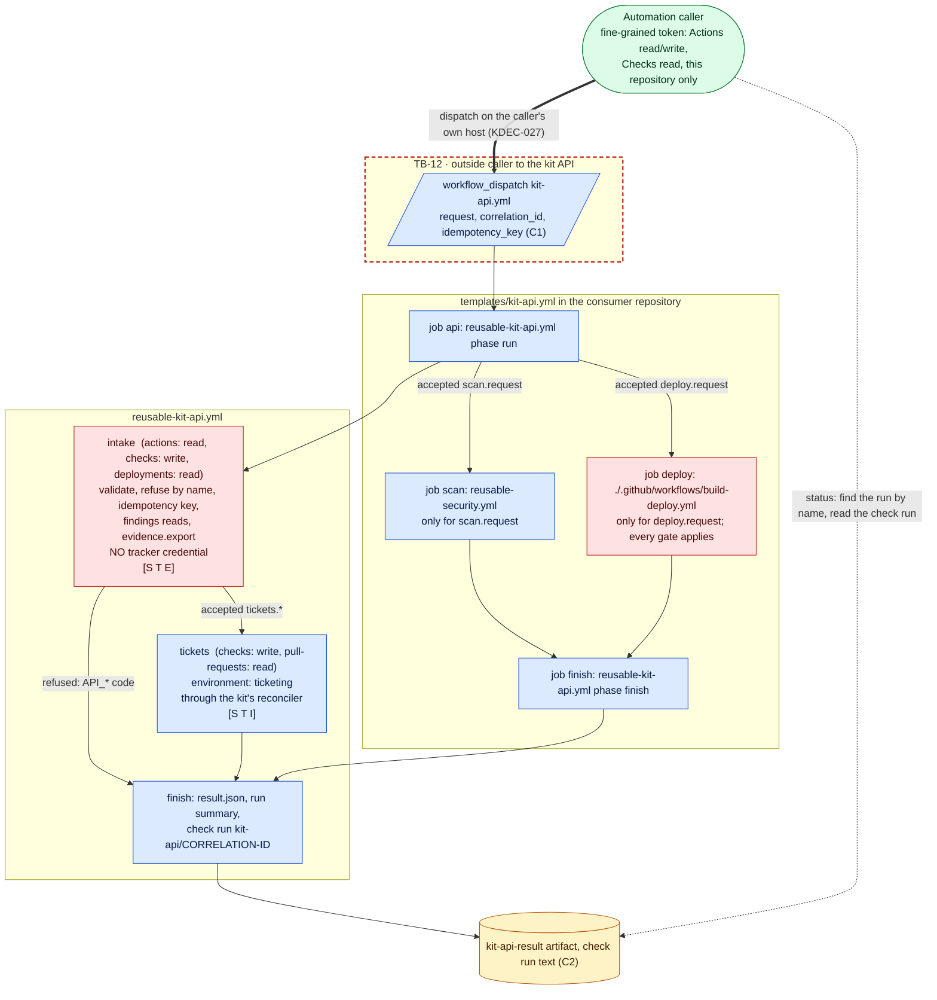

# 03e · Components: the kit API

```
Kept:      2026-11-07, drawn against the trunk at c1420ea. Notation: 00_NOTATION_AND_LEGEND.md.
Status:    PROPOSED (KDEC-035). Built and proven locally; no hosted armed call per operation yet.
Containers: templates/kit-api.yml, .github/workflows/reusable-kit-api.yml, .github/actions/kit-api,
            scripts/kit_api.py (client), scripts/kit_api_server.py (run side), api/v1/ (the contract).
Design:    10e_DESIGN_KIT_API.md. One call end to end: ARCH_04_KIT_API.md. Contract: docs/api/README.md.
```

## 1 · The jobs a call runs through



Cited: `templates/kit-api.yml` jobs `api`, `scan`, `deploy`, `finish`; `.github/workflows/reusable-kit-api.yml`
jobs `intake`, `tickets`, `finish`; `.github/actions/kit-api/action.yml` (phases); `scripts/kit_api_server.py`.

## 2 · The operations

| Operation | Kind | Served | Reaches |
|---|---|---|---|
| `tickets.get`, `tickets.search` | read | by default | the reconciler, in the `ticketing` environment; `tickets.search` can page the tracker (`scripts/ticket_intake.py`) |
| `findings.get`, `findings.search` | read | by default | a default-branch security run's `findings.json`, redacted |
| `evidence.export` | read | by default | the security record, release records, promotion records, outbox, ledger (KDEC-039; 03f) |
| `scan.request` | read-like | by default | `reusable-security.yml` at the requested ref |
| `status.get` | client only | nothing is sent | the check run of an earlier call |
| `tickets.write`, `tickets.comment` | write | only when `vars.KIT_API_OPERATIONS` names it; idempotency key required | the reconciler |
| `tickets.submit` | write | the same, and only from a FINALIZED review (KDEC-037) | `scripts/ticket_submit.py` |
| `deploy.request` | write | the same, and only for `vars.KIT_API_DEPLOY_ENVIRONMENTS` whose GitHub environment demands a human approver | the repository's own `build-deploy.yml` |

Each operation has one parameter schema in `api/v1/params/`. Refusal names are in `api/v1/refusals.json`.

## 3 · The components and what each holds

| Component | Code | Holds | Proof |
|---|---|---|---|
| client | `scripts/kit_api.py` | the host is never assumed (`API_HOST_NOT_NAMED`); the token goes only to that host, never followed through an artifact redirect | `tests/prove_kit_api_client.py` K1..K9, `tests/prove_dispatch_correlation.py` |
| intake | `scripts/kit_api_server.py intake` | the envelope against `api/v1/request.schema.json`; writes off unless named; idempotency | `tests/prove_kit_api_server.py` S1..S8 |
| tickets | `scripts/kit_api_server.py tickets` | the same reconciler, stamp and ledger as the pipeline, so one finding is one ticket | `tests/prove_kit_api_server.py`, `tests/prove_ticket_templates.py` |
| submit | `scripts/ticket_submit.py`, `scripts/ticket_templates.py`, `scripts/review_finalize.py` | review finalized and concurred by an approver who authored none of it; SoD per item; dedupe against every ticket | `tests/prove_ticket_templates.py`, `tests/prove_ticket_intake_v2.py` |
| workflow shape | `reusable-kit-api.yml`, `templates/kit-api.yml` | the tracker credential only in the tickets job; the deploy is the repository's own pipeline | `tests/prove_kit_api_workflow.py` W1..W8 |
| hosted refusal | self-test jobs `kit-api-refuses-by-name`, `kit-api-refusal-asserted` | a malformed call is refused by name on every hosted self-test | `.github/workflows/self-test.yml` |

## 4 · What the API never does

- It deploys nothing itself, dispatches nothing, approves nothing.
- It never writes a disposition, an exception, a register or the ledger. A ticket write leaves a
  ledger **proposal** as an artifact.
- It never closes a ticket. Closure is the reconciler's, on verified clearance, in a full run (KDEC-024).
- It never removes a gate: an agent's release always waits for a person
  (`API_DEPLOY_NEEDS_HUMAN_APPROVAL`); rollback and break-glass are refused (`API_RELEASE_PATH_NOT_PERMITTED`).

## 5 · Trust and threat notes

- TB-12: the caller's identity is the run's actor, so the caller can never approve its own release
  (the release-approval check refuses the requester).
- TB-4: every call goes to the run's own API host (KDEC-027).
- TB-5: the tracker credential is in reach of the `tickets` job only.
- Threat entries: [09_THREAT_MODEL.md](09_THREAT_MODEL.md) TH-TB12-*.
