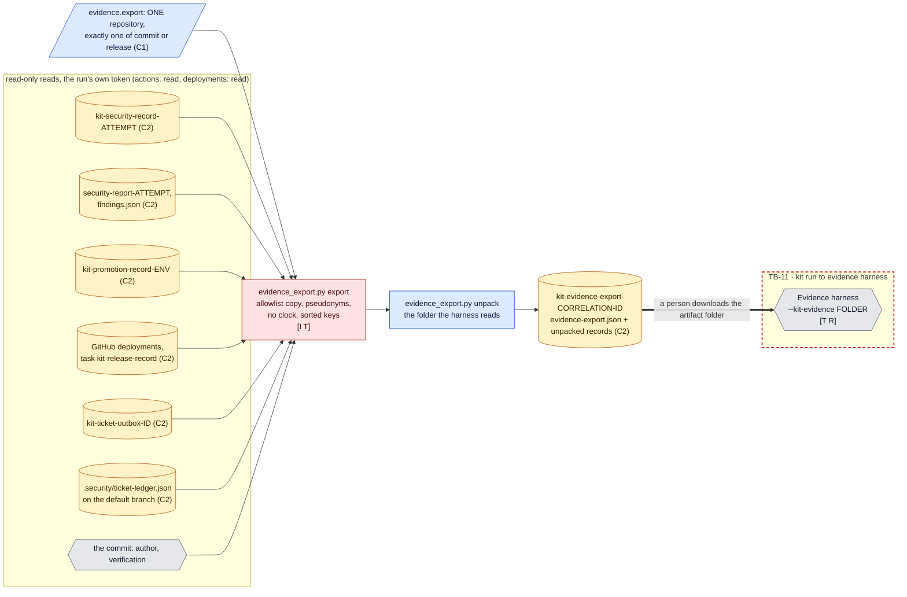

# 03f · Components: evidence export

```
Kept:      2026-11-07, drawn against the trunk at c1420ea. Notation: 00_NOTATION_AND_LEGEND.md.
Container: the kit API operation evidence.export (KDEC-039), run in reusable-kit-api.yml job intake.
Code:      scripts/evidence_export.py (export, unpack), called by scripts/kit_api_server.py.
Contract:  api/v1/evidence-export.schema.json (schema kit-evidence-export/1);
           api/v1/params/evidence.export.schema.json; docs/api/README.md section 7.5a.
Design:    10f_DESIGN_EVIDENCE_EXPORT.md. Into the harness: ARCH_06_EVIDENCE_TO_THE_HARNESS.md.
```

## 1 · What the export reads, and what it writes



Cited: `scripts/evidence_export.py`, `scripts/kit_api_server.py`, `.github/workflows/reusable-kit-api.yml`
steps "Read and search the findings", "Answer a findings read", "Keep the evidence export".

## 2 · The ten sections of the answer

Each section is ESTABLISHED with its records and their sources (artifact name, run id and sha256, or
deployment id), or NOT ESTABLISHED with the reason. Never an empty list standing in for a record nobody read.

| Section | Source |
|---|---|
| `security_record` | the newest `kit-security-record` of a run on that commit |
| `review_signals` | verdict provenance, weakening check, readiness source, tier reality, kit watermark |
| `promotion_records` | the live `kit-promotion-record` artifacts, and the summary each release record carries |
| `release_records` | the durable deployments with task `kit-release-record`, with their latest status |
| `findings` | identities, keys, rule, path, line, severity: never a message, a snippet or a detail |
| `ticket_outbox` | pending and drained outbox entries |
| `ticket_links` | each finding's ticket, from the ledger on the default branch |
| `kev` | the gate's KEV verdict, and whether any finding is on CISA KEV |
| `sbom` | the SBOM's sha256 |
| `author` | the commit author as `person:<10 hex>`, and the committer verification state; never an email |

## 3 · The rules, and the proof of each

| Rule | How | Proof |
|---|---|---|
| read-only | nothing is written but the answer and its artifact | `tests/prove_evidence_export.py` E1..E5 |
| one repository | a record naming another repository is counted (`excluded_other_repository`), never copied | the same file N1..N4 |
| no secrets, no free text | every record goes through an allowlist of its schema's fields; a credential-shaped value is withheld by name | the same file M1..M4 |
| idempotent | no clock is read; every list sorted on stable keys; `data.export_sha256` binds the whole | the same file |
| named refusals | `API_SCHEMA_VIOLATION` (not exactly one of commit and release), `API_REPOSITORY_NOT_SERVED`, `API_EVIDENCE_UNAVAILABLE` | the same file |
| a harness can read it | a bundle built by the harness from the export, in the proof | the same file |

## 4 · Trust and threat notes

- TB-11: the kit holds **one** evidence-store identity, in the scheduled copy-out only (KDEC-068): create-only
  in `cicd-kit-scans` and `cicd-kit-gates`. It cannot seal or write the harness's containers; the harness's
  writer and sealer are separate identities in the harness's own environments (ARCH-02 section 2).
- Information disclosure is the main threat: the allowlist copy and pseudonyms hold it.
- Tampering between export and harness: the export's `export_sha256` lets the harness detect a changed
  file; the transfer itself is a person downloading an artifact (residual, see TH-TB11-02).
- Threat entries: [09_THREAT_MODEL.md](09_THREAT_MODEL.md) TH-TB11-*.

## 5 · Not yet covered

An `evidence.export` from a real repository fed to the harness on a real case has not run (ARCH-06 section 3).
