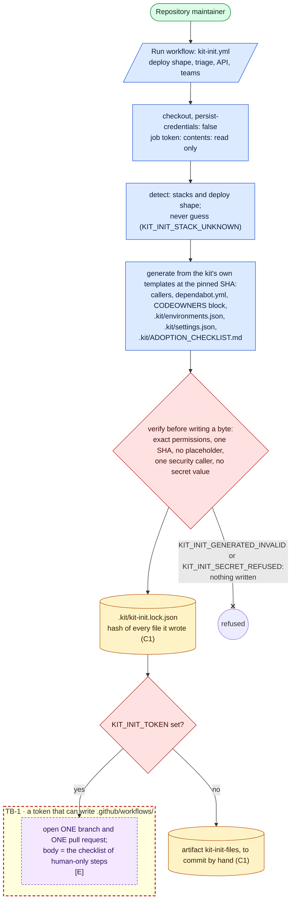

# 03g · Components: kit init

```
Kept:      2026-11-07, drawn against the trunk at c1420ea. Notation: 00_NOTATION_AND_LEGEND.md.
Containers: templates/kit-init.yml (a button), .github/actions/kit-init (the composite),
            scripts/kit_init.py (the command), scripts/consumer_surface_check.py (verification).
Decision:  KDEC-041 (adoption without "a million hoops").
Design:    10g_DESIGN_KIT_INIT.md. Guide: docs/adoption/GETTING_STARTED_1_HOUR.md.
```

## 1 · One run of kit init



Cited: `templates/kit-init.yml` (job `init`, `permissions: contents: read`); `.github/actions/kit-init/action.yml`
steps "PyYAML (pinned)", "kit init", "Upload the files (no KIT_INIT_TOKEN, so no pull request)",
"How to commit them"; `scripts/kit_init.py`.

## 2 · What it writes

| File | Why |
|---|---|
| the caller workflow: `build-deploy.yml` (container), `build-deploy-static.yml` (static site) or `security.yml` (scan only) | pinned to the kit by SHA; each job grants exactly the union of what the called workflow's jobs request |
| `dependabot-config-check.yml` and `.github/dependabot.yml` | from `scripts/dependabot_config.py generate` |
| optional `dependabot-triage.yml` (`--with-triage`), `kit-api.yml` (`--with-api`, container only) | the extras a team asked for |
| `kit-init.yml` | re-running is a dispatch |
| a CODEOWNERS block | AppSec owns `.kit/`, `.kit/zone-readiness.json`, `.security/`, the workflows, Dependabot config, Dockerfiles and IaC |
| `.kit/environments.json` | the environments spec: dev/test ungated; uat/prod with required reviewers from platform or security, self-review prevented, deployments from main only; each environment's `class` (KDEC-042) |
| `.kit/settings.json` | the answers; `approver_pools` and `app_team` are read by the deploy at uat/prod |
| `.kit/ADOPTION_CHECKLIST.md` | the PR body: environments and reviewers with `gh api` commands, the OIDC federated credential per environment with this host's issuer, the readiness attestation outside a landing zone, the secret and variable **names** to set |

## 3 · The components and what each holds

| Component | Code | Holds | Proof |
|---|---|---|---|
| detect | `scripts/kit_init.py --detect` | python, node, dotnet, java, php, go, static, container, terraform, bicep; several at once | `tests/prove_kit_init.py` |
| generate | `scripts/kit_init.py` | only from the kit's own templates at the pinned commit (`KIT_INIT_PIN_NOT_CHECKOUT` otherwise) | `tests/prove_kit_init.py` |
| verify | `scripts/kit_init.py`, `scripts/consumer_surface_check.py` R1, `tests/check_caller_permissions.py` rules | nothing more and nothing less than each callee requests | `tests/prove_kit_init.py`; `tests/prove_kit_init.py --actionlint` in self-test |
| idempotence | `.kit/kit-init.lock.json` | a file a person edited is preserved and listed (`KIT_INIT_HUMAN_EDIT_PRESERVED`) | `tests/prove_kit_init.py` |
| plain words | `scripts/plain_errors.py` | every `KIT_INIT_*` state said in a sentence | `tests/prove_plain_errors.py` |

## 4 · What it never does

- It never writes a secret. It takes none, and refuses output that contains a secret-shaped value.
- It never changes a repository setting, an environment, a reviewer, a ruleset or a credential. Those are
  the checklist's, for a person.
- It never pushes with the run's own token: a workflow's token cannot change `.github/workflows/`.

## 5 · Identities

| Identity | Scope | Used for |
|---|---|---|
| the job token | `contents: read` | the checkout only |
| `KIT_INIT_TOKEN` (optional) | a fine-grained token or GitHub App token for **this repository only**: Contents, Pull requests and Workflows, read and write | pushing the branch and opening the PR |

Threat entries: [09_THREAT_MODEL.md](09_THREAT_MODEL.md) TH-TB1-04.
