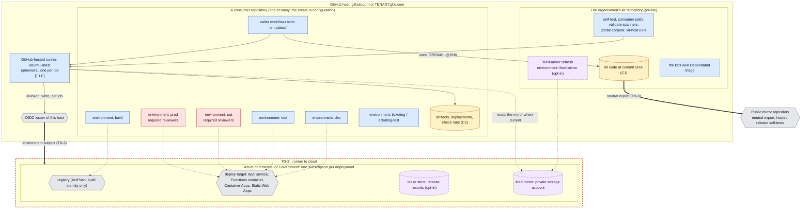

# 04 · Deployment view: where each part runs, and as whom

```
Kept:      2026-11-07, drawn against the trunk at c1420ea. Notation: 00_NOTATION_AND_LEGEND.md.
Audience:  whoever sets up the kit repository, a consumer repository, its environments and identities.
Rule:      the kit runs nowhere but on GitHub-hosted runners (or a runner label a caller names).
           There is no kit server. Every identity is per job, per environment, least privilege.
```

## 1 · The deployment diagram



## 2 · Where each piece runs

| Piece | Runs in | Runner | Trigger |
|---|---|---|---|
| `reusable-security.yml` | the consumer repository (a call) | hosted, `ubuntu-latest` | push, PR, dispatch, API scan |
| `workflow-policy-check.yml` | the consumer repository | hosted | push, PR, dispatch |
| `reusable-build-docker.yml` | the consumer repository, environment `build` | hosted | push to main |
| deploy reusables | the consumer repository, environment `dev`/`test`/`uat`/`prod` | hosted, or `runner_label` | push to main (dev, test); a person's dispatch (uat, prod) |
| `reusable-deployed-scan.yml` | the consumer repository, each environment named | hosted | daily schedule; break-glass |
| `reusable-rollback-sequence.yml` | the consumer repository, the target's environment | hosted, or `runner_label` | a person's dispatch |
| `reusable-ticket-reconcile.yml` | the consumer repository, environment `ticketing` or `ticketing-test` | hosted | push, schedule, dispatch; never a PR |
| `reusable-propose-ledger.yml` | the consumer repository, default branch only | hosted | push to the default branch |
| `reusable-kit-api.yml` | the consumer repository; tickets job in `ticketing` | hosted | an outside dispatch |
| `reusable-dependabot-*.yml` | the consumer repository | hosted | pull_request_target from Dependabot; push; schedule |
| `reusable-external-findings.yml` | the consumer repository; submit in the review environment | hosted | schedule, dispatch |
| `reusable-exception-due.yml` | the consumer repository; resurface in `ticketing` | hosted | schedule, dispatch |
| `reusable-feed-mirror-refresh.yml` | the kit repository, environment `feed-mirror` | `KIT_FEED_MIRROR_RUNNER` (a runner that can reach the private endpoint) | schedule, dispatch |
| `verify-azure-oidc.yml` | the repository whose identity is checked, in the named environment | hosted | dispatch |
| `self-test.yml` and the other kit-host workflows | the kit repository and the public mirror | hosted | push, PR, dispatch |
| `tools/battery.py` | a maintainer's machine | local | before every push |

## 3 · Which identity runs it

| Piece | Identity | What it may do |
|---|---|---|
| every job | the run's `GITHUB_TOKEN`, scoped per job (contents: read by default) | only what the job declares; only on the run's own API host (KDEC-027) |
| build | Azure build identity, federated to environment `build` | AcrPush on the application's registry repository; nothing else |
| deploy dev/test/uat/prod | Azure deploy identity, federated to that environment | the target app and its slots, Reader on its resource group; no registry role; never subscription scope |
| deployed scan | the environment's vended identity (the deploy identity works) | read the target |
| feed-mirror refresh | Azure refresh identity, federated to environment `feed-mirror` of the kit repository | write the mirror storage account |
| ticket jobs | tracker credential from the protected environment | the tracker projects the routing names |
| attest job | the run's OIDC token with `attestations: write` (the only job holding it) | sign build provenance |
| kit init PR | `KIT_INIT_TOKEN` (optional) | push one branch and open one PR in this repository |

The full identity table, with the rulings it follows, is [07_IDENTITY_AND_ACCESS.md](07_IDENTITY_AND_ACCESS.md).

## 4 · Hosting constraints

- `$/` (the kit at the caller's pinned commit) needs a github.com-style host and runner 2.336.0 or
  later. GitHub Enterprise Server is not supported (`reusable-security.yml`, plan job notes).
- A GHE.com tenant has its own OIDC issuer (`token.actions.TENANT.ghe.com`); each federated credential
  names it (`docs/adoption/SETUP.md` section 4).
- The feed mirror is a static website on a private endpoint; only runners that reach that endpoint
  read it. Others fall back as `KIT_FEED_MIRROR_FALLBACK` says, and record why (KDEC-032).
- A private repository whose plan has no attestations holds V1 as `IMPLEMENTATION_HELD`
  (`vars.ATTESTATIONS_AVAILABLE`); a public repository arms it regardless.

## 5 · Proof

`tests/prove_ghe_host.py`, `tests/prove_github_token_stays_on_its_host.py` (host rule);
`tests/prove_azure_gov_audience.py` (cloud); `tests/prove_attest_job_isolated.py` (attest job);
`tests/check_caller_permissions.py` (per-job grants); `tests/prove_feed_mirror.py` (mirror use).
