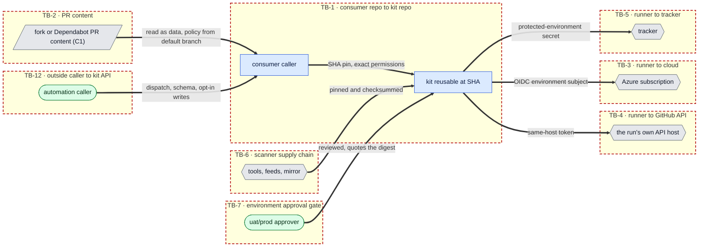

# 05 · Trust boundaries

```
Kept:      2026-11-07, drawn against the trunk at c1420ea. Notation: 00_NOTATION_AND_LEGEND.md.
Audience:  a security reviewer; anyone changing a control. A change that moves, adds or removes a
           boundary obliges a threat review (THREAT_MODEL.md section 7).
Rule:      each boundary names what crosses it, the control that holds it, and the PROOF: a file in
           tests/ that shows the control refuses what it must. Every cited file exists
           (tests/check_mermaid_diagrams.py M5).
Relation:  THREAT_MODEL.md (2026-10-06) named eight boundaries B1..B8. This page keeps them and adds
           six the kit has grown since. Mapping: B1 -> TB-1/TB-2, B2 -> TB-4, B3 -> TB-6, B4 -> TB-8,
           B5 -> TB-3, B6 -> TB-11, B7 -> TB-14, B8 -> TB-7/TB-10.
```

## 1 · All boundaries on one page



TB-8 (artifact identity), TB-9 (public mirror), TB-10 (org overlay and settings precedence), TB-11
(evidence harness), TB-13 (external intake) and TB-14 (shared deploy target) are drawn in their own
sections below.

## 2 · The boundaries

### TB-1 · Consumer repository to the organisation's kit repository

- **What crosses:** the consumer's `uses:` call; its `with:` inputs and secrets; the kit code at the
  pinned commit; the permissions the caller grants.
- **Controls:**
  - every kit reference is a full 40-hex SHA, never a branch or a moving tag;
  - the caller grants exactly what the called jobs request: no less (GitHub refuses the run), no more;
  - every caller input reaches a script as `env:` data, never as script text;
  - inlined kit scripts are checked against their pinned digest in every job;
  - the kit's own pins of third-party actions are full SHAs naming a release.
- **Proof:** `tests/check_action_pins.py`, `tests/check_caller_permissions.py`, `tests/lint_injection.py`,
  `tests/check_expression_length.py`, `tests/prove_kit_script_digests.py`, `tests/prove_deploy_inputs_via_env.py`,
  `tests/prove_pin_scope_covers_composites.py`.
- **State:** PROVEN-LOCAL; exercised on every hosted self-test.

### TB-2 · Pull-request content to a privileged context

- **What crosses:** the code, title, body and branch name of a pull request (possibly from a fork, or
  from Dependabot) into a job that holds a token or a secret.
- **Controls:**
  - the workflow policy gate refuses `pull_request_target` with a head checkout, issue titles in `run:`,
    secrets: inherit, tag-pinned images and more (rules R1..R9 and the reusable-call rules);
  - Dependabot triage checks out nothing and reads the PR as data; its caller is read from the default branch;
  - the gate's policy, the baseline ledger and dispositions are read from the protected default branch,
    never the PR tree;
  - ticketing, the ledger proposal and the deferral clock refuse every pull-request event before any
    credential is requested;
  - test-only secret seeds can only add files, never change the scanned tree.
- **Proof:** `tests/prove_workflow_policy_rules.py`, `tests/prove_triage_job_permissions.py`,
  `tests/prove_dependabot_triage.py`, `tests/prove_gate_reads_rung.py`, `tests/prove_ledger_read_authority.py`,
  `tests/prove_ticket_reconcile_workflow.py`, `tests/prove_propose_ledger_job_scope.py`,
  `tests/prove_test_only_seeds_add_only.py`; hosted self-test jobs `ticket-reconcile-refuses-pr` and
  `ledger-proposal-refuses-pr`.
- **State:** PROVEN-LOCAL. A real fork PR against the privileged path has not been run (the original threat model, T-01).

### TB-3 · Runner to cloud (OIDC)

- **What crosses:** a GitHub OIDC token exchanged for an Azure access token.
- **Controls:**
  - the federated credential subject is the environment form `repo:ORG/REPO:environment:ENV` (or the
    id-qualified form), never a branch, tag or `pull_request` subject;
  - one federated credential per deployment, per consumer repository, per environment; the identity
    holds roles in exactly one subscription;
  - `id-token: write` is granted per job; the policy gate WARNS (does not refuse) when a workflow with
    more than one job grants it at workflow level;
  - the bind step refuses, before login, a call whose tier, target or cloud disagrees with what the
    environment was vended;
  - the audience is per cloud: `api://AzureADTokenExchange` or `api://AzureADTokenExchangeUSGov`;
  - `verify-azure-oidc.yml` proves the boundary read-only: the token's own claims, the directory side
    (no client secret, one subscription), and probes that must be refused.
- **Proof:** `tests/prove_oidc_subject_forms.py`, `tests/prove_context_integrity_refuses.py`,
  `tests/prove_oidc_directory_checks.py`, `tests/prove_deploy_environment_binding.py`,
  `tests/prove_azure_gov_audience.py`, `tests/prove_boundary_evidence_visible.py`,
  `tests/check_deploy_environment_declared.py`.
- **State:** the refusals before login are ENFORCED (section 3); commercial sign-in PROVEN-LIVE on a personal
  sandbox; Government sign-in is asserted, not yet live.

### TB-4 · Runner to the GitHub API (the job token)

- **What crosses:** `GITHUB_TOKEN` and any API call the kit makes.
- **Controls:** every call goes to the run's own `GITHUB_API_URL`, never `api.github.com` from a GHE.com
  run (KDEC-027); a rejected token is named once, early, with an owner role; external text never reaches
  `$GITHUB_OUTPUT` or `$GITHUB_ENV` unsanitised; the kit API client never follows an artifact redirect with
  the token.
- **Proof:** `tests/prove_github_token_stays_on_its_host.py`, `tests/prove_ghe_host.py`,
  `tests/prove_job_token_named.py`, `tests/check_output_writes.py`, `tests/prove_kit_api_client.py`.
- **State:** PROVEN-LOCAL; exercised on github.com.

### TB-5 · Runner to tracker

- **What crosses:** the tracker credential; finding identities and descriptions; ticket state.
- **Controls:** one job holds the credential, from the `ticketing` (or `ticketing-test`) environment, with
  `contents: read` and a timeout; the branch, not a variable, chooses test or real; `JIRA_REAL_PROJECTS`
  refuses a test run aimed at a real project; the Jira host may itself be a secret; a lookup always comes
  before a create; Freshservice markers are notes, so a person's tags are never overwritten.
- **Proof:** `tests/prove_ticket_reconcile_workflow.py`, `tests/prove_jira_auth_and_routing.py`,
  `tests/prove_jira_host_secret.py`, `tests/prove_ticket_backends.py`, `tests/prove_ticket_idempotency.py`,
  `tests/prove_freshservice_tracker.py`.
- **State:** PROVEN-LOCAL; Jira PROVEN-LIVE on a personal site only.

### TB-6 · Scanner supply chain and data feeds

- **What crosses:** scanner binaries, container images, rule sets, the NVD datafeed, CISA KEV, the Trivy
  DB, OSV data.
- **Controls:** every tool is an exact version, and downloaded bytes are checked with `sha256sum -c`; pinned
  images must resolve; a scanner that could not acquire its tool is `DEPENDENCY_ACQUISITION_UNAVAILABLE`,
  never clean; the organisation mirror is used only when `MIRROR_CURRENT` (fresh and every file matching
  its manifest's sha256); the capability floor keeps a scanner expected even if its registry row is
  deleted; seeded corpora measure each scanner.
- **Proof:** `tests/check_pinned_installs.py`, `tests/check_pinned_artifacts.py`, `tests/prove_feed_mirror.py`,
  `tests/prove_feed_mirror_gaps.py`, `tests/prove_capability_floor.py`, `tests/prove_hollow_scan.py`,
  `tests/prove_validate_scanners.py`, `tests/prove_iac_corpus.py`, `tests/prove_php_corpus.py`.
- **State:** PROVEN-LOCAL; scanner corpora run on a schedule (`probe-scanner-corpora.yml`).

### TB-7 · The environment approval gate (uat and prod)

- **What crosses:** a release into a production environment.
- **Controls:** the deploy reads the environment's protection back and refuses before login unless it has
  required reviewers, self-review prevented, the named approver groups, a platform or security pool
  reviewer, and is not approvable by the app team alone; the run's own approval must exist, not be the
  requester's or the commit author's, and quote the digest; a push straight to main never reaches uat or
  prod without that approval (KDEC-042).
- **Proof:** `tests/prove_uat_prod_gating.py`, `tests/prove_deploy_environment_protection.py`,
  `tests/prove_release_gates.py`, `tests/check_deploy_environment_declared.py`,
  `tests/prove_positive_clean_release.py`.
- **State:** PROVEN-LOCAL; not yet run hosted against a real uat or prod environment.

### TB-8 · Build to registry to deploy (artifact identity)

- **What crosses:** the image (or static site) from the build to the registry to the target.
- **Controls:** build once; scan before push; push the scanned bytes; assert the registry holds what was
  scanned (`REGISTRY_IDENTITY_PROVEN`); deploy by digest only; V1 attestation verification before login;
  promotion moves the same digest, never a rebuild; a static site's identity is its tree digest.
- **Proof:** `tests/check_artifact_identity.py`, `tests/prove_build_push_round_trip.py`,
  `tests/prove_composite_build_once.py`, `tests/prove_deploy_attestation.py`, `tests/prove_attestation_verify.py`,
  `tests/prove_promotion.py`, `tests/prove_deploy_staticwebapp.py`, `tests/prove_stamp_consistency.py`.
- **State:** PROVEN-LOCAL; attestation armed on public repositories only.

### TB-9 · Private kit to the public mirror

- **What crosses:** a copy of the kit.
- **Controls:** the export is a fresh tree with no history; every deny-list pattern refuses the export
  (each pattern carries a sample it must match); overlays, `.context/`, the export profiles and the deny
  list itself are never shipped; the neutral core is checked on every self-test, not only at export.
- **Proof:** `tests/check_export_safety.py`, `tests/prove_export_scope.py`, `tests/prove_deny_samples.py`,
  `tests/check_custody.py`, `tests/prove_custody_overlays.py`, `tests/check_source_hygiene.py`.
- **State:** PROVEN-LOCAL; exercised on every public-mirror release.

### TB-10 · Organisation overlay and central register versus consumer settings (precedence)

- **What crosses:** policy: the rung, per-control minimums, approver lists, ticket routing, exceptions.
- **Controls:** the central register at the kit pin and the repository register on the protected default
  branch are two copies of one format; the highest authority's rung is the floor and narrower scopes only
  tighten (`POLICY_BELOW_AUTHORITY_FLOOR`); crawl is the absolute floor, so secrets block whatever any input
  says; an unreadable register is `REGISTRATION_UNAVAILABLE`, never the default; an overlay adds and never
  relaxes; a weakening needs five fields and an approver who is not the requester.
- **Proof:** `tests/prove_policy_registration.py`, `tests/prove_authority_floor.py`, `tests/prove_crawl_floor.py`,
  `tests/prove_gate_policy_enforcement.py`, `tests/prove_approver_list_source.py`, `tests/check_weakening_record.py`,
  `tests/prove_reviewer_signals.py`, `tests/check_custody.py`.
- **State:** PROVEN-LOCAL.

### TB-11 · Kit run to the evidence harness

- **What crosses:** `evidence.export` and the kit's artifacts, into a per-app bundle.
- **Controls:** read-only; one repository; allowlist copy, no free text, pseudonymous authors; the same reads
  give the same bytes, bound by `export_sha256`; the kit holds no evidence-store identity.
- **Proof:** `tests/prove_evidence_export.py`.
- **State:** PROVEN-LOCAL; not yet fed from a real repository into a real case.

### TB-12 · Outside caller to the kit API

- **What crosses:** a v1 request by `workflow_dispatch`, and its result.
- **Controls:** the request validates against `api/v1/request.schema.json` or is refused by name; writes are
  off unless `vars.KIT_API_OPERATIONS` names them; every write needs an idempotency key; the caller is the
  run's actor and so can never approve its own release; break-glass and rollback are refused.
- **Proof:** `tests/prove_kit_api_client.py`, `tests/prove_kit_api_server.py`, `tests/prove_kit_api_workflow.py`;
  hosted self-test jobs `kit-api-refuses-by-name`, `kit-api-refusal-asserted`.
- **State:** PROVEN-LOCAL; refusals exercised hosted; no armed hosted call yet.

### TB-13 · External finding sources to the kit (SonarQube, Aikido)

- **What crosses:** findings the kit did not produce.
- **Controls:** the pull is read-only (never writes to the vendor or a tracker); each item validates against
  the `finding` template; a write happens only through `tickets.submit` after a recorded concurrence with the
  finalized review, in an environment whose reviewers are the human gate; the submit never re-pulls.
- **Proof:** `tests/prove_external_findings_pull.py`, `tests/prove_external_findings_workflow.py`,
  `tests/prove_ticket_templates.py`, `tests/prove_external_evidence.py`.
- **State:** PROVEN-LOCAL against stand-ins.

### TB-14 · Kit deploy and landing zone on a shared target

- **What crosses:** writes to a resource both the landing zone and the kit can change.
- **Controls:** one owner per field (`KIT_SETTING_KEYS`); a cross-repository lease with a fencing token checked
  before and after every mutation (opt-in, `KIT_TARGET_LEASE_ACCOUNT`); an App Service swap never carries a
  landing-zone setting into production; an app rollback refuses a shared entry; deploys of one app queue,
  never cancel; ownership is stamped on what was deployed.
- **Proof:** `tests/prove_target_lease.py`, `tests/prove_target_lease_crossrepo.py`,
  `tests/prove_seam_setting_ownership.py`, `tests/prove_seam_app_rollback_refuses_shared_entry.py`,
  `tests/prove_deploy_concurrency.py`, `tests/prove_deploy_ownership_stamp.py`.
- **State:** PROVEN-LOCAL against an emulated Blob service; not run against real Azure Storage; off until the
  owner rules on KDEC-030.

## 3 · Which boundary controls have refused a real operation

- **ENFORCED** (refused a real prohibited operation outside a test): the deploy's refusals before login,
  on TB-3 and TB-8. The stage register (`tests/check_stage_phase.py`, stage 15) records a deploy on a
  BLOCKED verdict refused before login (run 38853176286), an irreversible prod deploy refused
  (38853184615), and, on TB-14, a second actor's change not overwritten (38886279650).
- Every other boundary control is PROVEN-LOCAL or less. See [09_THREAT_MODEL.md](09_THREAT_MODEL.md)
  for each residual.
