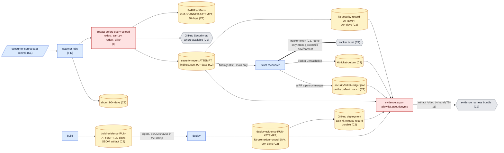

# 06 · Data flows, with classification

```
Kept:      2026-11-07, drawn against the trunk at c1420ea. Notation: 00_NOTATION_AND_LEGEND.md
           (classes C0 public, C1 internal, C2 confidential, C3 secret).
Audience:  a security reviewer asking "where does this data go, who can read it, how long is it kept".
Rule:      a C3 value (a token, a key) never appears in a document, an artifact or a log. Only its
           NAME is written. Retention below is what the code sets, read from each upload step.
```

## 1 · The flows on one page



"90+ days" means `KIT_EVIDENCE_RETENTION_DAYS`, floored at 90 and capped at 400 (KDEC-036 G6).

## 2 · Findings

| Step | Where | Class | Control | Proof |
|---|---|---|---|---|
| produced | each scanner job, as SARIF | C2 | the scanner reports class and location, never the matched secret value | `tests/prove_redaction_chain.py` |
| redacted | "Redact credential material before upload", before every upload | C2 | the same redaction on every path | `tests/check_redaction_parity.py` |
| validated | `scripts/sarif_validity.py`, before any count | C2 | a malformed SARIF is one UNPARSEABLE row, never zero | `tests/prove_validity_before_upload.py`, `tests/prove_malformed_sarif_isolated.py` |
| published | `upload-sarif` where the plan offers code scanning; else `PUBLICATION=DEGRADED` | C2 | publication failure never rewrites the verdict | `tests/check_published_sarif_has_producer.py` |
| reported | `scripts/scan_report.py`: `findings.json` in `security-report-ATTEMPT` | C2 | identity keys, rule, path, line, severity | `tests/prove_report_emits_findings.py` |
| ticketed | `scripts/reconcile_tickets.py`, main only | C2 | description reaches the tracker as `env:` data | `tests/prove_ticket_reconcile_workflow.py` |
| read by API | `findings.get`, `findings.search` | C2 | a default-branch run's findings only | `tests/prove_kit_api_server.py` |
| exported | `evidence.export` | C2 | never a message, a snippet or a detail | `tests/prove_evidence_export.py` |

A **secret** finding is keyed by a non-reversible fingerprint (KDEC-038), ticketed urgent with a ROTATE
action, and never closed because the value disappeared from the tree (`tests/prove_sast_secret_tickets.py`).

## 3 · SBOMs

| Step | Where | Class | Notes |
|---|---|---|---|
| security run | job `sbom` (Syft, pinned and verified); artifact `sbom` | C2 | licences checked (`scripts/sbom_licenses.py`; `tests/prove_sbom_licence_verdict.py`) |
| build | "SBOM (Syft, SPDX JSON)", before push; its sha256 in the version metadata stamp | C2 | the SBOM describes the bytes pushed (`tests/prove_stamp_consistency.py`) |
| promotion | the build's SBOM re-scanned under today's data, then the KEV re-check | C2 | the digest is never rebuilt to be scanned (`tests/prove_promotion.py`) |
| deployed scan | the serving digest's SBOM re-scanned daily | C2 | security drift reported apart from artifact drift |
| export | the SBOM's sha256 only | C2 | |

## 4 · Evidence and records

| Record | Written by | Kept | Class |
|---|---|---|---|
| `kit-scripts-ATTEMPT` | `plan` | 1 day (it is a run-internal bundle) | C0 |
| `sarif-*-ATTEMPT` | each scanner | 30 days | C2 |
| `security-report-ATTEMPT` (report, `findings.json`) | `security-gate` | 90+ days | C2 |
| `kit-security-record-ATTEMPT` | `reviewer-signals` | 90+ days | C2 |
| the run record (`schemas/assurance-result.schema.json`) | `run-record` | in the report artifact | C2 |
| `build-evidence-RUN-ATTEMPT` | build | 30 days | C2 |
| `deploy-evidence-RUN-ATTEMPT`, `kit-promotion-record-ENV` | deploy | 90+ days | C2 |
| GitHub deployment, task `kit-release-record` | deploy (`deployments: write`) | durable, survives artifact expiry | C2 |
| `releases/ENV/UTC-RUN-ATTEMPT.json` in the lease container | deploy, only with the lease on | create-only; retention is the landing zone's | C2 |
| `ticket-reconcile-ATTEMPT`, `ticket-resurface-ATTEMPT` | ticketing | 30 days | C2 |
| `decision.json` | Dependabot classify | 90 days | C1 |
| `kit-api-result-*`, `kit-evidence-export-*` | kit API | per the API workflow | C2 |

Residual: SARIF, build evidence and ticketing run records are kept 30 days, below the 90-day evidence
floor the security report and deploy records follow. See TH-TB11-03 in [09_THREAT_MODEL.md](09_THREAT_MODEL.md).

## 5 · Tickets

| Item | Lives in | Class | Control |
|---|---|---|---|
| the ticket | the tracker project the routing names | C2 | lookup before create; the full correlation key is the identity |
| the stamp | a tracker field, or the stamp line in the kit's machine-owned block | C1 | a label is only a search aid (`scripts/ticket_governance.py`) |
| the outbox | artifact `kit-ticket-outbox-ID` | C2 | durable, drained first by the next run |
| the ledger | `.security/ticket-ledger.json` on the default branch | C2 | changed only by a PR a person merges |
| a review record | `.security/reviews/REVIEW_ID.json` on the default branch | C2 | merged by a PR its concurring reviewer approved (KDEC-037) |

## 6 · Tokens and secrets (names only)

| Name | Kind | Where it lives | Who reads it |
|---|---|---|---|
| `GITHUB_TOKEN` | job token | minted per job | that job only; its own API host only |
| the OIDC ID token | short-lived JWT | minted per job with `id-token: write` | `azure/login`; `actions/attest` |
| `AZURE_TENANT_ID`, `AZURE_SUBSCRIPTION_ID`, `AZURE_CLIENT_ID` | identifiers, not secrets (C1) | environment variables, passed in `secrets:` slots | the deploy, build, scan and refresh jobs |
| `JIRA_TOKEN`, `JIRA_EMAIL`, `JIRA_HOST` (optional secret) | tracker credential | `ticketing` / `ticketing-test` environments | the reconcile, resurface and API tickets jobs |
| `AZDO_PAT`, `GH_TICKET_TOKEN`, `FRESHSERVICE_API_KEY` | tracker credentials | the same | the same |
| `SONAR_TOKEN`, `SONAR_HOST_URL`, `AIKIDO_CLIENT_ID`, `AIKIDO_CLIENT_SECRET` | external source credentials | the repository or its environment | the external-findings pull job |
| `NVD_API_KEY` | feed key | repository or environment | the NVD workflow |
| `SEMGREP_APP_TOKEN` | optional rules token | repository | the Semgrep job |
| `DEPENDABOT_METADATA_TOKEN`, `DEPENDABOT_COMMAND_TOKEN` | optional tokens | repository | the triage classify job; keep-current's comment |
| `KIT_INIT_TOKEN` | optional token | repository | kit init's PR step |
| `KIT_API_TEAM_READ_TOKEN` | optional token (members: read) | repository or environment | the API's approver-team read |

Controls: `scripts/redact_sarif.py` patterns for cloud keys and tokens; `scripts/kit_init.py` refuses
output with a secret-shaped value; `scripts/evidence_export.py` withholds credential-shaped values by
name; the push ruleset blocks secret-file paths server-side (`tests/prove_push_ruleset_secret_files.py`).

## 7 · Logs and run summaries

- Logs and step summaries are C2: they are readable by anyone with read access to the repository.
- A refusal's own body reaches the log, with any JWT-shaped string printed as `[redacted-jwt]`
  (`tests/prove_boundary_evidence_visible.py`).
- A value that is not a plain name is never echoed ("a value that is not a plain name, not shown"; the
  deploy's bind step).
- No step writes external text into `$GITHUB_OUTPUT` or `$GITHUB_ENV` unsanitised (`tests/check_output_writes.py`).
- Plain-words annotations name the state; they never quote a finding's matched value (`scripts/plain_errors.py`).
