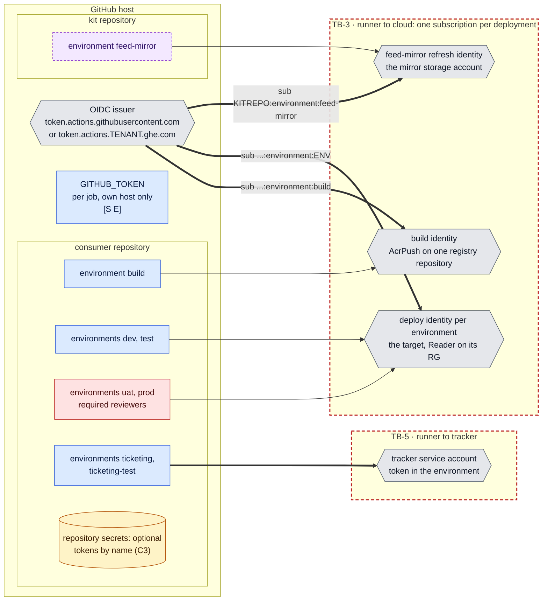

# 07 · Identity and access architecture

```
Kept:      2026-11-07, drawn against the trunk at c1420ea. Notation: 00_NOTATION_AND_LEGEND.md.
Audience:  whoever creates federated credentials, tokens and environments, and whoever reviews what
           each identity can reach.
Rule:      no client secret anywhere in the kit. Every cloud identity is federated from the GitHub
           host's OIDC issuer to ONE GitHub environment of ONE repository, and holds roles in ONE
           subscription. Every job token is scoped per job. The tables below were generated from the
           permissions blocks in the code, then checked by hand.
Picture:   ARCH_02_IDENTITIES_AND_TRUST.md (who signs in to what).
```

## 1 · The identity rulings this follows

| Ruling | What it means for the kit |
|---|---|
| One reader service principal per tenant | the tenant reader belongs to the evidence harness and to read-only automation, not to the kit. The kit holds no tenant-wide reader. The deployed scan reads with the identity each environment vends (the deploy identity works) |
| Landing-zone vending service principals per environment class | the landing zone's own identities that create environments and write their `KIT_*` values. They are outside the kit; the kit only reads what they vend (`KIT_HANDOFF_ISSUER` records that they did) |
| OIDC per deployment, limited to one subscription | each deploy identity is federated to one environment of one repository and has roles only in that deployment's subscription; `verify-azure-oidc.yml` checks "one subscription" from the directory side |
| A separate federated credential per consumer | the subject names the consumer repository (`repo:ORG/REPO:environment:ENV`), so no two consumers share a credential; one credential per environment (editing one replaces it, `docs/adoption/SETUP.md` section 4) |

## 2 · The identities, and where each lives



## 3 · Cloud identities (federated, no key)

| Identity | Federated subject | Audience | Roles, at what scope | Must NOT hold |
|---|---|---|---|---|
| build | `repo:ORG/REPO:environment:build` | `api://AzureADTokenExchange` (commercial) or `api://AzureADTokenExchangeUSGov` (gov; or `KIT_AZURE_OIDC_AUDIENCE`) | AcrPush on the application's registry repository | any deploy role |
| deploy, one per environment | `repo:ORG/REPO:environment:ENV`, or the id-qualified form `repo:ORG@org-id/REPO@repo-id:environment:ENV` | as above | Website Contributor on the web app and slots, or Container Apps Contributor on the container app; Reader on the resource group; with the lease on, Storage Blob Data Contributor on its own lease container; a custom role holding only the Front Door purge action on its own endpoint | any role at subscription or management-group scope; any role on another app; User Access Administrator or Owner; any registry role (the app's own managed identity pulls) |
| deployed-scan reader | the environment's vended identity (the deploy identity works) | as above | read the target | write anything |
| feed-mirror refresh | `repo:ORG/KITREPO:environment:feed-mirror` | as above | write the mirror storage account (Entra-authorised upload) | anything else |
| OIDC verifier | whatever identity is being checked | as above | none needed to sign in; Reader on the probed scopes | anything it would create (it asserts nothing changed) |

The subject never names the cloud; the issuer is always the GitHub host's; only the audience changes with
the cloud (ARCH-07). Proof: `tests/prove_oidc_subject_forms.py`, `tests/prove_azure_gov_audience.py`,
`tests/prove_oidc_directory_checks.py`, `tests/prove_context_integrity_refuses.py`.

## 4 · The job token, per job (least privilege)

`contents: read` unless a job needs more. Every API call goes to the run's own host (KDEC-027).

| Workflow | Job | Permissions | Environment |
|---|---|---|---|
| `reusable-security.yml` | `plan` | contents: read, security-events: read | - |
| `reusable-security.yml` | each scanner job | contents: read, security-events: write (SARIF upload) | - |
| `reusable-security.yml` | `codeql` | contents: read, security-events: write, actions: read | - |
| `reusable-security.yml` | `security-gate` | contents: read | - |
| `workflow-policy-check.yml` | `policy-check` | contents: read | - |
| `reusable-build-docker.yml` | `build` | contents: read, id-token: write | build |
| `reusable-build-docker.yml` | `attest` | contents: read, id-token: write, attestations: write (the only job with it) | - |
| deploy reusables | `deploy` | contents: read, id-token: write, attestations: read, actions: read, deployments: write, pull-requests: read | the deploy environment |
| `reusable-deployed-scan.yml` | `scan` / `report` | contents: read, id-token: write, actions: read / contents: read | each environment / - |
| `reusable-rollback-sequence.yml` | `rollback` | contents: read, id-token: write, actions: read | the target's environment |
| `reusable-ticket-reconcile.yml` | `guard`, `sweep` | contents: read | - |
| `reusable-ticket-reconcile.yml` | `reconcile`, `resurface` | contents: read | ticketing or ticketing-test |
| `reusable-propose-ledger.yml` | `propose-ledger` | contents: write, pull-requests: write; never on a PR, default branch only | - |
| `reusable-exception-due.yml` | `list` / `resurface` | contents: read | - / ticketing or the test environment |
| `reusable-kit-api.yml` | `intake` | contents: read, actions: read, checks: write, deployments: read | - |
| `reusable-kit-api.yml` | `tickets` | contents: read, actions: read, checks: write, pull-requests: read | ticketing |
| `reusable-kit-api.yml` | `finish` | contents: read, actions: read, checks: write | - |
| `reusable-external-findings.yml` | `pull` / `submit` | contents: read / contents: read, actions: write | - / the review environment |
| `reusable-dependabot-triage.yml` | `classify` | contents: read, pull-requests: read | - |
| `reusable-dependabot-triage.yml` | `auto-merge` | contents: write, pull-requests: write | - |
| `reusable-dependabot-triage.yml` | `human-review` | contents: read, pull-requests: write, issues: write | - |
| `reusable-dependabot-triage.yml` | `close` | contents: read, pull-requests: write | - |
| `reusable-dependabot-keep-current.yml` | `keep-current` | contents: read, pull-requests: write | - |
| `reusable-dependabot-config-check.yml` | `check` | contents: read, pull-requests: read | - |
| `reusable-ticket-reference.yml` | `validate-reference` | contents: read, pull-requests: read | - |
| `reusable-nvd-cve.yml` | `nvd-cve-scan` | contents: read, security-events: write | optional |
| `reusable-feed-mirror-refresh.yml` | `refresh`, `images` | contents: read, id-token: write | feed-mirror |
| `verify-azure-oidc.yml` | `verify` | id-token: write, contents: read | the one checked |
| `templates/kit-init.yml` | `init` | contents: read (the PR is pushed with `KIT_INIT_TOKEN`) | - |

A caller grants each called job's union, exactly (`tests/check_caller_permissions.py`). A job missing a
permission it calls with fails the static check (`tests/prove_triage_job_permissions.py` for triage).

## 5 · Tokens the kit expects a person to create (all optional unless named)

| Secret name | Scope it should have | Used by | Without it |
|---|---|---|---|
| `JIRA_TOKEN` (+ `JIRA_EMAIL`, optional `JIRA_HOST`) | a service account on the routed projects | ticketing, API tickets job, exception resurfacing | `TICKETING_NOT_CONFIGURED`; nothing written |
| `AZDO_PAT` | work items read and write, one organisation | the same, backend azdo | the same |
| `GH_TICKET_TOKEN` | issues read and write on the one `TICKET_REPO` | the same, backend github | the same |
| `FRESHSERVICE_API_KEY` | the workspace named | the same, backend freshservice | the same |
| `KIT_INIT_TOKEN` | fine-grained or App token, this repository only: Contents, Pull requests, Workflows, read and write | kit init's PR | files uploaded as `kit-init-files` to commit by hand |
| `KIT_SURVEY_TOKEN` | read-only across the organisation: Metadata, Contents, Actions, Administration, Secrets and Variables READ, organisation Members and Administration READ | the org survey and setup check (GET only) | the run refuses by name |
| `DEPENDABOT_COMMAND_TOKEN` | a maintainer's fine-grained token, pull requests read and write, this repository only | keep-current's comment and close, never reading | the run's own token posts the comment |
| `DEPENDABOT_METADATA_TOKEN` | Dependabot alerts: read | triage classify | the security linkage is NOT established |
| `KIT_API_TEAM_READ_TOKEN` | members: read of the approver team | the API's approver-team read | the approver list comes from the register |
| `SONAR_TOKEN`, `AIKIDO_CLIENT_ID` / `AIKIDO_CLIENT_SECRET` | read access to the projects; issues: read | external findings pull | that source is not pulled |
| `NVD_API_KEY`, `SEMGREP_APP_TOKEN` | the vendor's key | NVD workflow; Semgrep managed rules | rate-limited updates; the bundled rules |

The outside caller of the kit API brings its own token: fine-grained, this repository only, Actions read and
write, Checks read, Metadata read; never Contents write (`templates/kit-api.yml` header).

## 6 · Separation of duties carried by identity

| Who | May | May not | Enforced by |
|---|---|---|---|
| the PR author | push, request a release | approve a uat/prod release of their own change | `scripts/release_gates.py` (`SELF_DEPLOYMENT_APPROVAL`) |
| the release requester (a person or the API caller) | dispatch a promotion | approve it | the same |
| the uat/prod reviewer | approve, quoting the digest | be the requester or the commit's author | the same; `scripts/environment_protection.py` |
| AppSec | issue `.kit/zone-readiness.json`; type a manual-review verdict | be the PR's author; review their own request | `scripts/reviewer_signals.py` |
| a weakening approver | approve on a registered list | be the requester, actor or release author (`WEAKENING_SELF_APPROVED`) | `scripts/reviewer_signals.py` |
| a ticket fixer | resolve | verify their own fix | `scripts/reconcile_tickets.py`, `scripts/ticket_model.py` |
| a review's concurring approver | concur | have authored any of the reviewed items | `scripts/review_finalize.py`, `scripts/ticket_submit.py` (`SOD_SELF_APPROVAL`) |

## 7 · What is not yet covered

- No AWS federated identity (no AWS adapter).
- Government sign-in is asserted (the audience and environment each step asks for) but not run live.
- `verify-azure-oidc.yml` checks one identity per dispatch; nothing sweeps every federated credential of an
  estate. Suggested mitigation (PROPOSED): a scheduled harness-side read of every app registration's
  federated credentials against the rulings in section 1, using the tenant reader.
