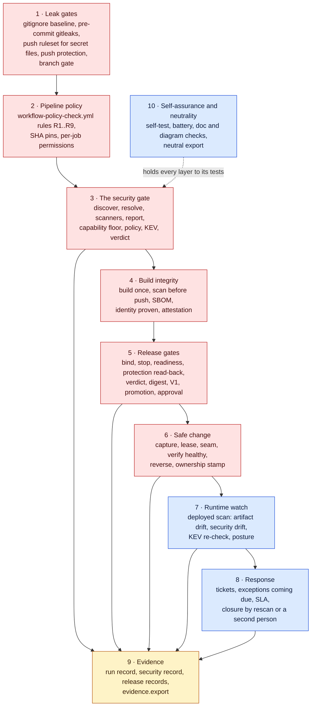

# 08 · Security architecture in one place

```
Kept:      2026-11-07, against the trunk at c1420ea. Notation: 00_NOTATION_AND_LEGEND.md.
Audience:  a CISO, a security reviewer, an auditor: what defends what, and how we know.
Detail:    boundaries 05, data 06, identities 07, threats 09 and 09b. Review procedure:
           docs/security-review/README.md (the reviewer's steps and checklists).
```

## 1 · The principles the code follows

| Principle | Where it shows in the code |
|---|---|
| **One enforcement point.** Scanners report; only the gate decides | `reusable-security.yml` job `security-gate`; scanner jobs fail only when they could not scan |
| **Fail closed.** An absent or unreadable input is never a pass | absent verdict = `EVIDENCE_UNTRUSTED` (template `verdict` job); unreadable register = `REGISTRATION_UNAVAILABLE`; unreadable KEV = advisory, never PROCEED |
| **Never a fabricated zero.** "Nobody looked" is not "nothing found" | `scripts/scan_report.py` (`NOT ESTABLISHED`); `tests/prove_hollow_scan.py` |
| **Refuse before login.** Every deploy check runs before the cloud identity is used | the deploy reusables' step order; ENFORCED at stage 15 |
| **Least privilege per job.** No job inherits; each declares | the permissions table in 07 section 4 |
| **Data, never script text.** Inputs reach scripts through `env:` | `tests/lint_injection.py`, `tests/prove_deploy_inputs_via_env.py` |
| **Read authority from the protected branch.** A PR cannot choose its own rules | policy register, ledgers, review records |
| **Separation of duties.** The requester, author and approver are different people | `scripts/release_gates.py`, `scripts/reviewer_signals.py`, `scripts/review_finalize.py` |
| **One owner per field.** The landing zone and the kit never revert each other | `scripts/target_lease.py`, the seam step (KDEC-030) |
| **Say it plainly.** Every refusal is a sentence first, then its state name | `scripts/plain_errors.py`, `docs/errors/ERRORS.md` |
| **The kit checks itself.** Every claim in a document is checked against the code where it can be | `tests/check_doc_currency.py`, `tests/check_mermaid_diagrams.py`, `tests/check_code_walkthrough_coverage.py` |

## 2 · Layers of defence, from a developer's laptop to production



| Layer | Code | Proof | Boundary |
|---|---|---|---|
| 1 leak gates | `developer-safety/` (hooks, gitignore baseline, push ruleset, branch-protection profiles); the gate's leak-gate posture | `tests/prove_push_ruleset_secret_files.py`, `tests/prove_leak_gate_posture.py`, `tests/prove_baseline_gitignore.py`, `tests/check_branch_protection_profiles.py` | TB-2 |
| 2 pipeline policy | `workflow-policy-check.yml`; `tests/check_action_pins.py` for the kit itself | `tests/prove_workflow_policy_rules.py` | TB-1, TB-2 |
| 3 security gate | `reusable-security.yml` and its composites | 03a section 2 | TB-1, TB-6, TB-10 |
| 4 build integrity | `reusable-build-docker.yml`, `.github/actions/docker-build-push`, `.github/actions/static-site-package` | 03b section 2 | TB-8 |
| 5 release gates | the deploy reusables before login | 03b section 4 | TB-3, TB-7, TB-8 |
| 6 safe change | `scripts/deploy_contract.py`, `scripts/target_lease.py`, `scripts/rollback_sequence.py` | `tests/prove_deploy_now_serving.py`, `tests/prove_target_lease_crossrepo.py`, `tests/prove_rollback_sequence.py` | TB-14 |
| 7 runtime watch | `reusable-deployed-scan.yml` | `tests/prove_promotion.py`, `tests/prove_deployed_scan_lz_vocabulary.py` | TB-3 |
| 8 response | `reusable-ticket-reconcile.yml`, `reusable-exception-due.yml` | 03c section 3 | TB-5 |
| 9 evidence | `scripts/run_record.py`, `scripts/reviewer_signals.py`, `scripts/evidence_export.py` | `tests/prove_gate_run_record.py`, `tests/prove_release_record_store.py`, `tests/prove_evidence_export.py` | TB-11 |
| 10 self-assurance | `.github/workflows/self-test.yml`, `tools/battery.py`, `scripts/export_for_adoption.py` | `tests/prove_battery_mirrors_selftest.py`, `tests/check_selftest_coverage.py`, `tests/check_export_safety.py` | TB-9 |

## 3 · Controls by STRIDE letter

| Letter | Main controls |
|---|---|
| S spoofing | OIDC environment subjects per deployment; the Dependabot author check; full correlation key verification; authenticated tracker identity compared with the claimed integration |
| T tampering | SHA pins; script digests; build once and digest only; V1 attestation; authority read from the protected branch; the ledger only by PR; the capability floor |
| R repudiation | the run record, security record and durable release record; stamps and the ledger; weakening records with five fields; exception history from git |
| I disclosure | redaction before every upload; secret fingerprints; allowlist export with pseudonyms; the token stays on its host; the deny list and fresh-tree export |
| D denial (incl. a false clean) | `NOT_ESTABLISHED`, never zero; acquisition and mirror states; KEV unavailable is advisory; bounded jobs and timeouts; creation ceilings |
| E elevation | per-job permissions; refusals before login; environment protection read back; requester, author and approver distinct; writes off by default in the API |

## 4 · What a reviewer reads, and where

| Question | Where the kit answers it |
|---|---|
| did the gate run every scanner it should? | the report's per-scanner rows; the capability floor state; `controls_unavailable` |
| who softened a control, and until when? | `weakening_record`, `weakening_attribution` in the run outputs; the security record |
| was this release approved by someone independent? | `release_approval`, `release_approval_by` in the deploy outputs and the release record |
| is what serves what was scanned? | the promotion record's digest; the deployed scan's artifact drift |
| where is the evidence for this app? | `evidence.export`; [03f_COMPONENTS_EVIDENCE_EXPORT.md](03f_COMPONENTS_EVIDENCE_EXPORT.md) |

The reviewer's procedure (CAB changes and adoption reviews), checklists and sign-off are in
`docs/security-review/` (start with `docs/security-review/README.md` and
`docs/security-review/CAB-CHANGE-REVIEW-CHECKLIST.md`).

## 5 · Known limits at this commit

- One stage is ENFORCED (deployment and verification); the rest are PROVEN-LOCAL or less (09 section 5).
- No AWS adapter; no live Government sign-in; no hosted armed kit API call.
- The lease, the seam, the release block and the edge purge are opt-in; a green run with them off is not a
  governed deployment (ARCH-01 section 2).
- The suggested mitigations in 09 section 6 are PROPOSED.
