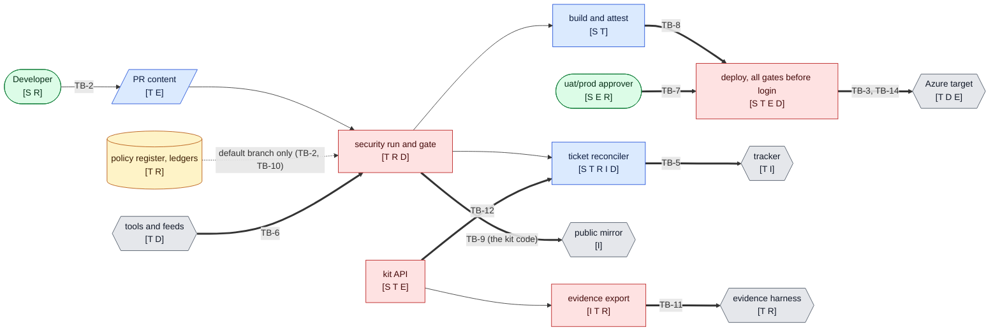

# 09 · Threat model (STRIDE), method and element view

```
Kept:      2026-11-07, against the trunk at c1420ea. Notation: 00_NOTATION_AND_LEGEND.md.
Parts:     this page (method, assets, the STRIDE matrix per element, the summary) and
           09b_THREATS_BY_BOUNDARY.md (every threat: control, proof, state, residual, suggested
           mitigation). THREAT_MODEL.md keeps the original sixteen threats T-01..T-16, re-read today.
Audience:  anyone changing the kit, and anyone signing off on a release that uses it.
When:      re-review on any change listed in THREAT_MODEL.md section 7 (an identity, a boundary, a
           scanner's acquisition path, the deployment target, the recovery design).
```

## 1 · Method

1. **Elements** come from the C4 views (01 to 04): people, outside systems, containers, stores.
2. **Boundaries** come from [05_TRUST_BOUNDARIES.md](05_TRUST_BOUNDARIES.md): TB-1 to TB-14.
3. For each element, each **STRIDE** letter is asked as a question (00 section 6). A letter that
   applies gets a threat id `TH-TB<n>-<nn>` under the boundary it crosses.
4. Each threat names its **control**, the **proof** file that shows the control refuses, its **state** on
   the ladder, its **residual**, and, where a residual is worth acting on, a **suggested mitigation**
   marked PROPOSED.
5. "Denial" includes the quiet kind: a control that did not run and reports clean.

## 2 · What is being protected (assets)

| Asset | Class | Why it matters |
|---|---|---|
| the deploy targets and what they serve | C2 | a bad release reaches users |
| the federated cloud identities | C3 (names C1) | standing access to a subscription |
| the job token and tracker credentials | C3 | write access to code, checks and tickets |
| the gate's verdict | C1 | the single enforcement point; a false PROCEED is the worst outcome |
| findings and SBOMs | C2 | a map of what is exploitable |
| evidence and release records | C2 | what an auditor relies on; must not be lost or forged |
| the policy register, ledgers and dispositions | C1/C2 | who decided how hard a control bites |
| the neutral kit | C0 | must name no one |

## 3 · The threat-annotated context



## 4 · STRIDE per element

Each cell names the threat ids in [09b_THREATS_BY_BOUNDARY.md](09b_THREATS_BY_BOUNDARY.md). "-" means the
letter was asked and no threat applies beyond those listed elsewhere.

| Element | S | T | R | I | D | E |
|---|---|---|---|---|---|---|
| consumer caller (templates) | - | TB1-01, TB1-03 | - | - | - | TB1-02, TB1-03 |
| PR content | TB2-03 | TB2-02, TB2-05 | - | TB2-04 | - | TB2-01, TB2-04 |
| kit scripts in a run | - | TB1-05 | - | - | - | - |
| scanner jobs | - | TB6-01 | - | TB5-06 | TB6-02, TB6-06, TB6-07 | - |
| the gate and its report | - | TB6-05 | TB10-03 | - | TB6-02, TB6-04 | - |
| policy register and exceptions | - | TB10-01, TB10-02, TB10-04 | TB10-03, TB10-05 | - | TB10-02 | TB10-01 |
| feed mirror and KEV | - | TB6-03 | - | - | TB6-03, TB6-04 | - |
| build and attest | TB8-02 | TB8-01 | - | - | - | - |
| GitHub environments (uat, prod) | - | TB7-04 | - | - | - | TB7-01, TB7-02, TB7-03, TB7-05, TB7-06 |
| deploy job | TB3-01 | TB3-03, TB8-03, TB8-04 | TB8-04 | - | - | TB3-02, TB3-04 |
| Azure target and lease | - | TB14-01, TB14-02 | - | - | TB14-02, TB14-03 | - |
| job token and API host | - | TB4-02 | - | TB4-01 | TB4-04 | TB4-03 |
| ticket reconciler and tracker | TB5-04 | TB5-02, TB5-03, TB5-05 | TB5-04 | TB5-01, TB5-06 | TB5-03 | TB5-07 |
| kit API | TB12-01, TB12-04 | TB12-03 | - | - | - | TB12-01, TB12-02 |
| external intake | TB13-01 | TB13-01 | - | TB13-02 | - | TB13-02 |
| evidence export and harness | - | TB11-02 | TB11-03 | TB11-01 | - | - |
| neutral export and public mirror | - | TB9-03 | - | TB9-01, TB9-02 | - | - |
| kit init | - | - | - | - | - | TB1-04 |
| cloud identities | TB3-01, TB3-05 | - | - | - | TB3-05 | TB3-02 |

## 5 · Summary

Counted from 09b (63 threats across 14 boundaries).

| State | Threats |
|---|---|
| ENFORCED (a live refusal outside a test) | the deploy's refusals before login: TH-TB3-04; the deploy's half of TH-TB8-01; a run's own reversal in TH-TB14-03 |
| PROVEN-LOCAL | most of the rest |
| BUILT, not proven by a refusal test | TH-TB4-03 (job-token scope) |
| partial | TH-TB6-06 (in-step tool and rule-set currency) |

## 6 · The residuals worth acting on first

Each is PROPOSED, for the owner to accept, amend or reject. None is treated as done.

| Order | Threat | Suggested mitigation (PROPOSED) | Why first |
|---|---|---|---|
| 1 | TH-TB4-03 | a self-test job that attempts a write with a read-only job token and asserts the refusal | the cheapest first ENFORCED test on the token boundary (THREAT_MODEL section 5) |
| 2 | TH-TB6-06 | a scheduled currency inventory of every in-step tool and rule set, warn not fail | the only threat class still partly ABSENT |
| 3 | TH-TB2-01 | a hosted fork-PR fixture against a `pull_request_target` workflow | the most expensive threat if the control fails |
| 4 | TH-TB6-01 | pin detect-secrets, ruff and mypy and bring those jobs into `check_pinned_installs.py` scope | a known unpinned install inside the flagship |
| 5 | TH-TB11-03 | raise SARIF, build-evidence and ticketing run-record retention to `KIT_EVIDENCE_RETENTION_DAYS` | evidence an auditor may ask for expires at 30 days |
| 6 | TH-TB12-01 | an allowlist of caller identities at API intake | an enabled write is open to any holder of Actions write |
| 7 | TH-TB3-01, TH-TB3-02 | a harness-side sweep of every federated credential; the OIDC verifier on a schedule | the kit sees only the identity it is asked about |
| 8 | TH-TB1-01 | record in the leak-gate posture whether `policy / Workflow policy` is required (the profiles already require it) | a repository with no profile could move its kit pin to a branch |

## 7 · Relation to the original threat model

| THREAT_MODEL.md | Here |
|---|---|
| T-01 untrusted PR | TH-TB2-01 |
| T-02 input injection | TH-TB1-03 |
| T-03 token scope | TH-TB4-03 |
| T-04 silent acquisition failure | TH-TB6-02 |
| T-05 cannot parse | TH-TB6-07 |
| T-06 rule and advisory drift | TH-TB6-06 |
| T-07 artifact substitution | TH-TB8-01 |
| T-08 provenance asserted | TH-TB8-02 |
| T-09 identity scope | TH-TB3-01, TH-TB3-02 |
| T-10 publication failure | covered by the report's `PUBLICATION=DEGRADED` (06 section 2); no residual |
| T-11 sensitive content in evidence | TH-TB5-06, TH-TB11-01 |
| T-12 evidence tampering | TH-TB2-02, TH-TB11-02 |
| T-13 shared-resource mutation | TH-TB14-01 |
| T-14 unsafe rollback | TH-TB14-03 |
| T-15 approval bypass by vocabulary | the gate's `EVIDENCE_UNTRUSTED` for an absent verdict (03a section 3); `tests/prove_bootstrap_failure.py` |
| T-16 disposition inherited wrongly | fixed: `tests/prove_identity_durability.py`, `tests/prove_rule_family_upgrade.py` |

Security architecture in one page: [08_SECURITY_ARCHITECTURE.md](08_SECURITY_ARCHITECTURE.md).
