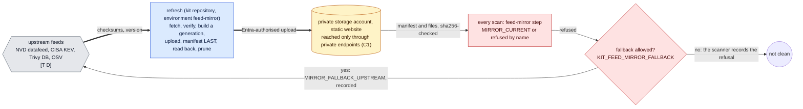

# 10i · Design: data feeds, the organisation mirror, KEV, NVD, and external finding intake

```
Kept:      2026-11-07, against the trunk at c1420ea. Boundaries: TB-6 and TB-13 in 05_TRUST_BOUNDARIES.md.
Code:      scripts/feed_mirror.py, scripts/feed_mirror_step.sh, .github/actions/feed-mirror,
           .github/actions/feed-mirror-refresh, reusable-feed-mirror-refresh.yml, infra/feed-mirrors/;
           scripts/known_exploited.py, .github/actions/known-exploited; reusable-nvd-cve.yml;
           scripts/external_findings_pull.py, reusable-external-findings.yml, scripts/finding_ids.py,
           scripts/unknown_ids.py.
Guides:    docs/adoption/FEED_MIRRORS.md; NVD_ABSTRACTION_ACCOUNTING.md.
```

## 1 · Purpose

- **Feeds**: give every scan current, intact vulnerability data (NVD, CISA KEV, the Trivy DB, OSV) and say,
  by name, when it cannot; never let a stale database read as clean.
- **External intake**: bring findings the kit did not produce (SonarQube, Aikido) into the same model and the
  same tickets, read-only, and written only behind a human review.

## 2 · The organisation mirror



- A mirror is used only when `MIRROR_CURRENT`: the manifest is readable, for this feed, refreshed within the
  policy (48 hours; a caller may only tighten), and every file matches its sha256.
- The manifest is uploaded last, so a reader never sees a half-written generation.
- The refresh also copies scanner images by digest and proves each resolves at the same digest.

## 3 · KEV and NVD

- **KEV**: read once per day (a date-keyed cache), mirror first, pinned in the evidence (catalog version,
  release date, sha256). A CVE on the catalog blocks at every rung unless excepted by fingerprint and CVE.
  An unreadable catalog is `KEV_UNAVAILABLE`, advisory, never a pass.
- **NVD** (`reusable-nvd-cve.yml`): Trivy filesystem, OWASP Dependency-Check with the NVD data (the mirror,
  else the project's datafeed, with or without `NVD_API_KEY`), a re-scan of a recorded SBOM and a deployed
  image, Dockerfile checks, then KEV. `fail_on_cvss` ships at 9.0 (owner ruling O-12).

## 4 · External intake (SonarQube, Aikido)

1. **Pull** (read-only): page through the vendor's issues and hotspots (SonarQube: Bearer token; Aikido:
   client credentials), map each to a `finding` item with provenance, normalise its ids
   (`scripts/finding_ids.py`), validate it against the template, dedupe against the kit's own findings, and
   keep the pull as an artifact. Never a write to the vendor or a tracker.
2. **Review**: a person reviews that exact pull; the review is finalized and concurred by an approver who
   authored none of it (`scripts/review_finalize.py`).
3. **Submit**: in the review environment (its required reviewers are the human gate), send each batch of that
   pull, unchanged, as `tickets.submit` to the repository's kit API. It never re-pulls.
4. An id the kit cannot read is logged durably and routed to a person (`scripts/unknown_ids.py`;
   `id-mappings.json` holds the reviewed mappings).

## 5 · States, in plain words

| State | In plain words |
|---|---|
| `feed_mirror.MIRROR_STALE` | The organisation's copy of a vulnerability database has not been refreshed recently enough. |
| `feed_mirror.MIRROR_UNREACHABLE` | The organisation's copy of a vulnerability database could not be reached from this runner. |
| `feed_mirror.MIRROR_INTEGRITY_FAILED` | The organisation's copy of a vulnerability database failed its integrity check (a file does not match its checksum). |
| `feed_mirror.MIRROR_FALLBACK_UPSTREAM` | The organisation's mirror was refused, and the public feed was read instead because the repository allows that fallback. |
| `feed_mirror_refresh.MIRROR_UPSTREAM_INTEGRITY_FAILED` | The downloaded vulnerability database does not match its own published checksums. |
| `feed_mirror_refresh.MIRROR_PUBLISH_UNVERIFIED` | The mirror was uploaded, but reading it back did not show a current, intact copy. |
| `known_exploited.UNAVAILABLE` | The known-exploited vulnerability check could not run: the catalog could not be fetched or read. |
| `external_findings_pull.SOURCE_AUTH_REFUSED` | SonarQube or Aikido refused the credentials (401/403). |
| `external_findings_pull.SOURCE_TRUNCATED` | SonarQube or Aikido stopped returning pages before all findings were read. |
| `external_findings_pull.SOURCE_HOST_REFUSED` | The SonarQube or Aikido host is not https, so no credential was sent. |
| `external_findings_pull.NOT_MAPPED` | A pulled finding could not be turned into a kit finding (no repository, file or known severity). |
| `unknown_id_review.NEEDS_MAPPING` | An id the kit could not read is waiting for a person to map it. |
| `finding_id_form.VULN_ID_FORM_UNKNOWN` | A finding carries a vulnerability id the kit does not recognise (not CVE, GHSA or OSV). |

## 6 · Failure modes

| Failure | What happens | Proof |
|---|---|---|
| the mirror stopped refreshing | `MIRROR_STALE`; the scan does not read it as current | `tests/prove_feed_mirror.py` |
| a mirror file was altered | `MIRROR_INTEGRITY_FAILED` | `tests/prove_feed_mirror.py` |
| an archive member escapes its directory | refused | `tests/prove_feed_mirror_gaps.py` |
| a vendor stops paging early | `SOURCE_TRUNCATED`; never a complete pull | `tests/prove_external_findings_pull.py` |
| a submit without a finalized review | `API_REVIEW_NOT_FINALIZED`, nothing written | `tests/prove_external_findings_workflow.py`, `tests/prove_ticket_templates.py` |
| an id in an unknown form | logged and routed to a person, never dropped | `tests/prove_unknown_ids.py`, `tests/prove_finding_ids.py` |

## 7 · Decisions

KDEC-022 (KEV blocks at every rung), KDEC-032 (the organisation hosts the feeds; used only when current
and intact), KDEC-037 (external findings through templates, written only after concurrence), KDEC-040
item 5 (SonarQube and Aikido pulled read-only).
