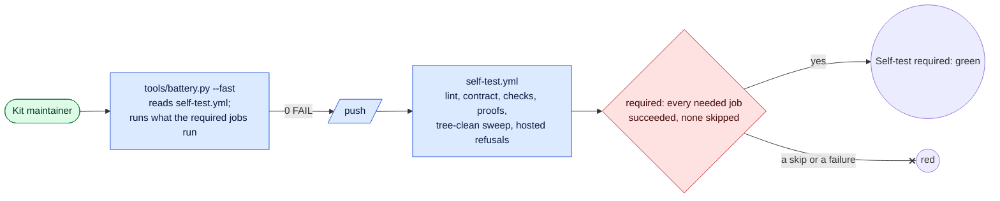

# 10j · Design: the neutral export, the public mirror, and how the kit checks itself

```
Kept:      2026-11-07, against the trunk at c1420ea. Boundary: TB-9 in 05_TRUST_BOUNDARIES.md.
Code:      scripts/export_for_adoption.py, scripts/export-deny.txt (never exported),
           scripts/export-profiles/ (never exported); .github/workflows/self-test.yml,
           scripts/selftest_required.py, tools/battery.py; tests/check_* and tests/prove_*.
Rules:     docs/PROOF_RULE.md (what a proof must show); docs/assurance/POSITIVE_NEGATIVE_MATRIX.md.
```

## 1 · Purpose

- **Export**: produce a copy of the kit for somebody else that names nobody (no account, no private
  repository, no employer, no client), with no git history to leak what a file no longer says.
- **Self-assurance**: make a green self-test mean exactly what it says, and no more: every check runs, a
  skipped required job is never green, and every document claim the code can refute is checked.

## 2 · The export

| Step | What happens |
|---|---|
| choose a profile | neutral by default; a profile names one recipient's overlay and the deny patterns lifted for that recipient only |
| build a fresh tree | tracked and unignored files only; no `.git`; never `.context/`, `overlays/` (unless the profile names one), `scripts/export-profiles/`, `scripts/export-deny.txt`, or the kit's internal consumer-path test workflow |
| scan | every deny pattern against every exported file, case-insensitively; a match refuses the export and writes nothing |
| prove the list | each deny pattern carries a `#+` sample it must match (`tests/prove_deny_samples.py`) |
| enforce continuously | `tests/check_export_safety.py` runs on every self-test, not only when someone exports |

**The remedy for a hit is substitution, never avoidance**: replace the name with a neutral descriptor ("a
reference estate"), keep the engineering fact (the header of `scripts/export-deny.txt`).

### The public mirror

The public mirror is a neutral export used to run hosted release self-tests where features a private
plan lacks are available (for example GitHub attestations). Consumers call the organisation's private copy.
A lane's work reaches the public mirror as a neutral export to a new branch, after which Self-test is
dispatched there and watched.

## 3 · Self-assurance



| Control | What it holds | File |
|---|---|---|
| the required verdict | never green by skipping, never pending by a path filter | `scripts/selftest_required.py`, `tests/prove_selftest_required.py` |
| the battery mirrors self-test | it reads the workflow, so the two cannot drift | `tests/prove_battery_mirrors_selftest.py` |
| every proof is run | a proof no workflow runs is refused by name | `tests/prove_proof_census.py` |
| self-test states its own coverage | on push, on schedule, on dispatch, by nothing | `tests/check_selftest_coverage.py` |
| the tree stays clean | every test runs in a throwaway clone and leaves no file behind | `tests/prove_tests_leave_tree_clean.py` |
| positive beside negative | every negative control has a positive pair or a named reason | `tests/check_positive_negative_pairing.py` |
| the stage ladder | no stage claims more maturity than its evidence | `tests/check_stage_phase.py` |
| prose matches the code | a document may not call an observed capability untested, or assert what the code refutes | `tests/check_doc_currency.py` |
| diagrams parse | every Mermaid block is structurally valid; the suite cites only paths that exist | `tests/check_mermaid_diagrams.py` |
| every file is explained | every tracked file has a walkthrough row; none is stale | `tests/check_code_walkthrough_coverage.py` |
| registers carry mitigations | every risk and decision entry has suggested mitigations, none completed by silence | `scripts/check_register_mitigations.py`, `tests/prove_register_mitigations.py` |
| the vocabulary is registered | every state word used is in the taxonomy | `scripts/reconcile_taxonomy.py` |

## 4 · States, in plain words

| State | In plain words |
|---|---|
| an export refusal | a deny pattern matched: the file, the line and the pattern's reason are printed, and nothing is written |
| a battery `UNKNOWN` (rc 2) | a tool or credential this host lacks; allowed unless `--strict` |
| a battery `FAIL` | any other non-zero exit or a timeout; the summary names each |
| `Self-test required` red | a job it needs failed or was skipped |

## 5 · Failure modes

| Failure | What happens | Proof |
|---|---|---|
| a new overlay appears | excluded from the day it exists, not the day someone remembers | `tests/prove_export_scope.py` |
| a deny pattern silently matches nothing (a control byte) | the sample proves it fails | `tests/prove_deny_samples.py`, `tests/check_source_hygiene.py` |
| a required job is skipped by a condition | the verdict job is red | `tests/prove_selftest_required.py` |
| a check runs only in the hosted run | the battery lists it as hosted-only rather than passing it | `tools/battery.py --list` |
| a document goes stale | the doc-currency gate fails, or reports it as known-stale until a date | `tests/check_doc_currency.py` |

## 6 · Decisions

KDEC-001 (the kit's own design documents are the build specification), KDEC-003 (consumer overlays are
tested here and never merge into the neutral kit), KDEC-005 and KDEC-006 (local proofs first, hosted runs per
milestone), KDEC-033 (skipped is never green), KDEC-040 (the battery in the repository; positive controls
beside negative ones).
