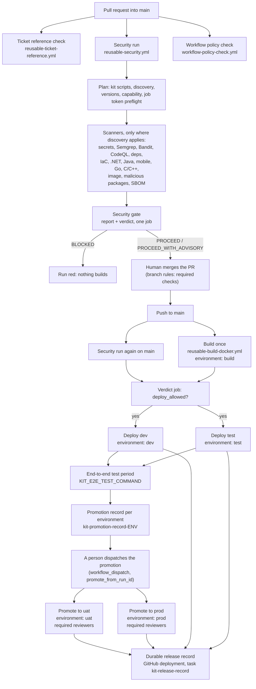
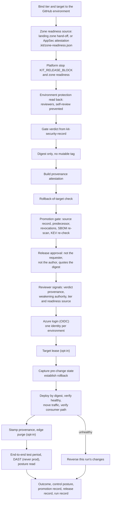

# ARCH-01 · The pipeline, end to end

```
Truth State:  drawn 2026-11-06 from the files cited under each diagram, on the trunk
              (fix/normalization-and-discovery). Release 4 (main 10ffcea) has the same shape:
              the trunk adds evidence.export (KDEC-039) and SAST/secret ticket keys (KDEC-038)
              after the scan, nothing on this path.
Audience:     whoever wires a repository to the kit, and whoever reviews what a green run means
What it is:   a picture of the declared structure. A diagram cannot establish that a pipeline
              works; the run summary, the outcome records and the proofs cited do.
```

## 1 · From pull request to release record



Cited: `templates/build-deploy.yml` (jobs `security`, `policy`, `build`, `verdict`, `deploy-dev`,
`deploy-test`, `promotion-source`, `promote`, `break-glass-scan`, `break-glass-tickets`);
`templates/security.yml`; `.github/workflows/reusable-security.yml` (jobs `plan` ... `security-gate`);
`.github/workflows/reusable-build-docker.yml`; `.github/workflows/reusable-deploy-containerapp.yml`
(and its two siblings `reusable-deploy-appservice.yml`, `reusable-deploy-staticwebapp.yml`);
`overlays/<name>/templates/*.yml` adds the ticket reference check in a consumer's own template.

- **uat and prod are promoted, never rebuilt** (KDEC-029). The digest built on `main` is the digest
  released; prod's predecessor is `vars.KIT_PROMOTION_PREDECESSOR` (`test` by default, or `uat`).
- **No prod release without a human.** The promotion is dispatched by a person, and the uat/prod
  environments must demand a required reviewer with self-review prevented; the deploy reads that
  protection back and refuses without it (section 2).
- **The release record** is a GitHub deployment with task `kit-release-record`. The deploy callers
  grant `deployments: write` and `pull-requests: read` for it (Release 4 migration impact).

## 2 · Inside one deploy: everything that can refuse does so before the cloud login



Cited: the step names of `.github/workflows/reusable-deploy-containerapp.yml`, in file order
("Bind the tier and target ... (refuse before login)" through "Keep the run record (deploy
evidence)"). The App Service and Static Web Apps adapters carry the same sequence. Refusal words:
`assurance-taxonomy.yaml`.

**A run that passes is not proof of governed deployment when the optional controls are off.** With
no `KIT_TARGET_LEASE_ACCOUNT` the cross-repository lease is skipped; with `KIT_RELEASE_BLOCK` unset
the release proceeds and records `RELEASE_BLOCK_NOT_VENDED`; a failed edge purge is an advisory; and
a repository that sets its own `KIT_ZONE_READINESS` is either refused at uat/prod
(`READINESS_SOURCE_SELF_SET_REFUSED`) or, with `KIT_ZONE_READINESS_TEST_FIXTURE: true`, recorded as
`READINESS_SOURCE_TEST_FIXTURE`, a test fixture, never an issued readiness
(`docs/adoption/ZONE_READINESS_ATTESTATION.md`).

## 3 · What is proven

Locally: the deploy proofs `tests/prove_deploy_*.py`, `tests/prove_promotion.py`,
`tests/prove_release_gates.py`, `tests/prove_reviewer_signals.py`, `tests/prove_release_record_store.py`.
Live on a personal sandbox for Release 1's adapters: `docs/assurance/RELEASE_1_EVIDENCE_MANIFEST.md`.
Not yet run hosted or live: the Release 4 steps (readiness attestation, approval bound to the digest,
release record) on a real Azure target.
