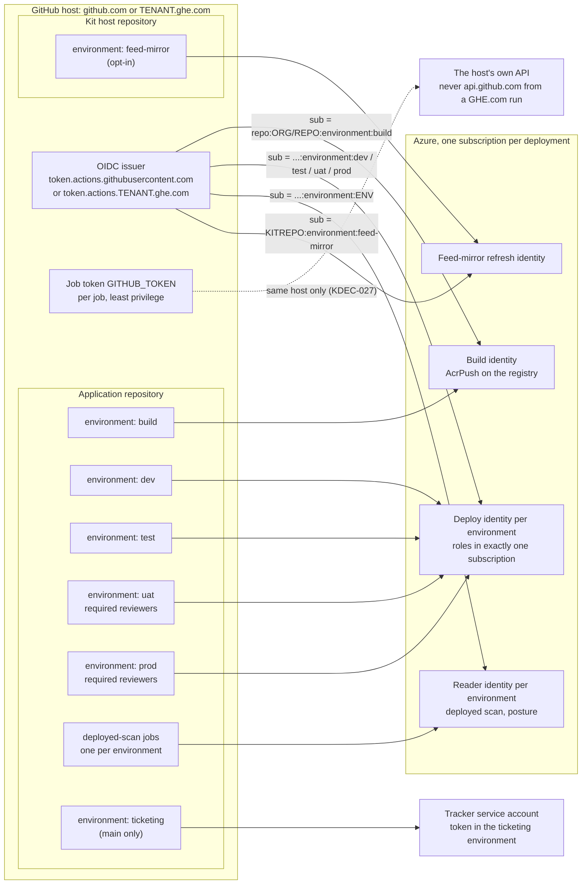
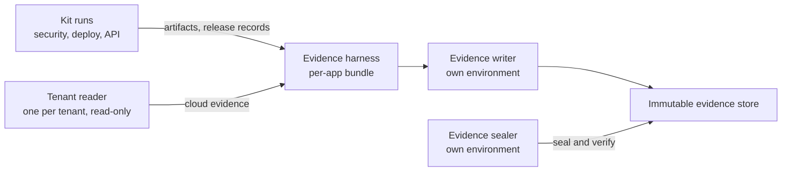

# ARCH-02 · Identities and trust

```
Truth State:  drawn 2026-11-06 from the files cited below, on the trunk. Release 4 (main 10ffcea)
              is the same for every identity shown.
Audience:     whoever creates the federated credentials, and whoever reviews what each can reach
Rule:         no client secret anywhere in the kit; every cloud identity is federated from the
              GitHub host's OIDC issuer to ONE GitHub environment of ONE repository.
```

## 1 · Who signs in to what



Cited: `templates/build-deploy.yml` (`github_environment: build`, `dev`, `test`, `inputs.environment`
for uat/prod; `id-token: write` per job), `templates/deployed-scan.yml` ("each environment's reader
identity"), `templates/feed-mirror-refresh.yml` and `.github/workflows/reusable-feed-mirror-refresh.yml`
(`github_environment: feed-mirror`), `.github/workflows/reusable-build-docker.yml` (the attest job is
the only one holding `attestations: write`), `.github/actions/azure-login-oidc/action.yml`,
`.github/workflows/verify-azure-oidc.yml` (prints the presented subject, `PLAIN` or `ID_QUALIFIED`,
and probes the authorization boundary), `.github/workflows/reusable-ticket-reconcile.yml`
(`environment: ticketing` on the default branch, `ticketing-test` elsewhere).

- **The subject is the environment form**, `repo:<org>/<repo>:environment:<env>`, or the
  id-qualified form `repo:<org>@<org-id>/<repo>@<repo-id>:environment:<env>`; never `ref:` or
  `pull_request` (`docs/adoption/SETUP.md` section 4; `tests/prove_oidc_subject_forms.py`).
- **The issuer is the host's.** github.com issues from `https://token.actions.githubusercontent.com`;
  a GHE.com tenant from its own issuer. The kit's federated-credential example in `SETUP.md` section 4
  shows the github.com issuer; on a GHE.com host replace it (`docs/adoption/SETUP.md` section 4.2).
- **The audience** is `api://AzureADTokenExchange` in commercial Azure and
  `api://AzureADTokenExchangeUSGov` in Azure Government (ARCH-07).
- **The job token never leaves its host** (KDEC-027): every API call goes to the run's own
  `GITHUB_API_URL`; `tests/prove_github_token_stays_on_its_host.py`, `tests/prove_ghe_host.py`.

## 2 · Identities outside the kit that its evidence meets

The kit holds no evidence-store identity. The evidence harness (a separate repository) writes cases
to an immutable evidence store with a **writer** identity and seals and verifies them with a separate
**sealer** identity, each federated to its own environment of the evidence repository; tenant
**readers** (one per tenant, read-only) collect the cloud evidence. The kit's side of that flow is
ARCH-06.



These three belong to the harness and the landing zone, not to this repository; they are drawn so a
reviewer can see that no kit identity can write or seal evidence.

## 3 · Separation of duties carried by identity

| who | may | may not |
|---|---|---|
| the developer who opened the PR | push, request a release | approve a uat/prod release of their own change (`SELF_DEPLOYMENT_APPROVAL`) |
| the uat/prod reviewer | approve, quoting the digest | be the requester or the commit's author |
| AppSec (`approver_lists.appsec`) | issue `.kit/zone-readiness.json` through an approved PR | be the PR's author |
| a weakening's approver (`weakening_approver`) | approve a weakening on a registered list | be the requester, actor or release author (`WEAKENING_SELF_APPROVED`) |
| a ticket's fixer | resolve | verify their own fix (closure needs another person or a rescan) |

Cited: `docs/adoption/POLICY_REGISTER.md` (approver lists, weakening), `docs/adoption/ZONE_READINESS_ATTESTATION.md`,
`docs/ticketing/SEPARATION-OF-DUTIES.md` (trunk), `.github/workflows/reusable-deploy-containerapp.yml`
("Release approval -- not the requester's or the author's own, bound to the digest").
