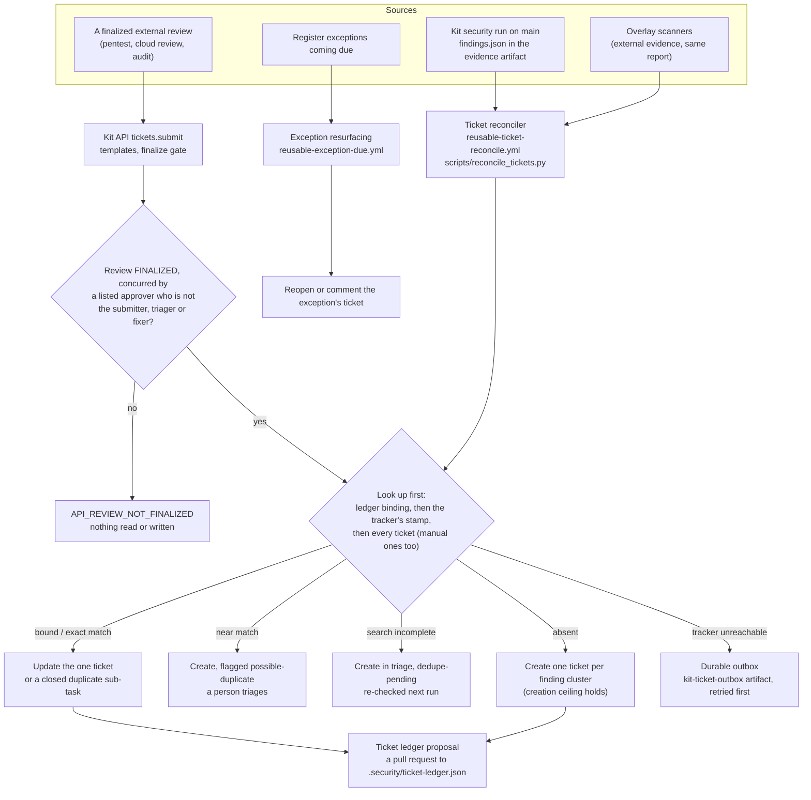
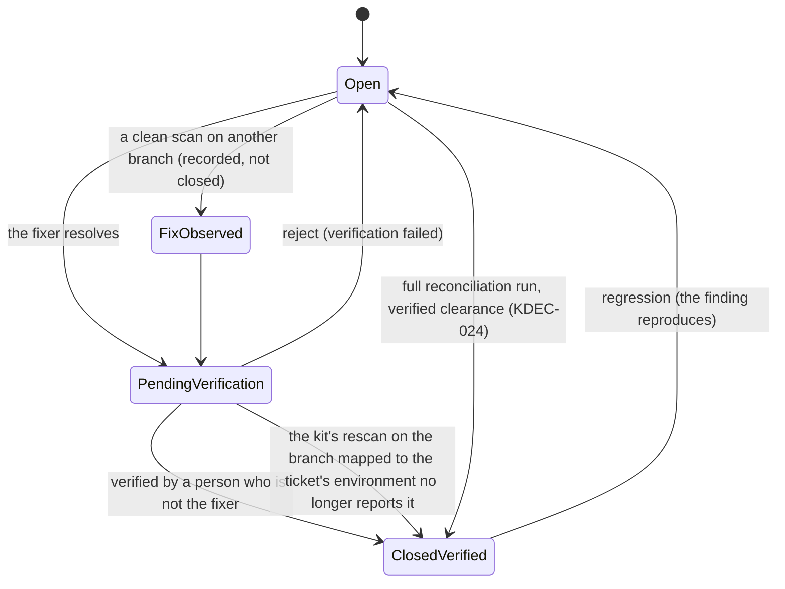

# ARCH-03 · Ticketing: from a finding to a closed ticket

```
Truth State:  drawn 2026-11-06 from the files cited below, on the trunk. Release 4 (main 10ffcea)
              carries everything here EXCEPT the SAST and secret ticket keys (KDEC-038, trunk only:
              in Release 4 a SAST finding has no ticket identity and is withheld, not ticketed;
              docs/KNOWN_DEFECTS.md D-8).
Audience:     whoever turns ticketing on, and whoever audits who closed what
Contracts:    docs/architecture/TICKETING_CONTRACT.md, docs/architecture/TICKETING_BACKENDS.md,
              docs/architecture/JIRA_AUTH_AND_ROUTING.md, docs/ticketing/ (trunk)
```

## 1 · Sources, intake, dedupe, tickets, closure



Cited: `.github/workflows/reusable-ticket-reconcile.yml` (jobs `guard`, `sweep`, `resurface`,
`reconcile`), `scripts/reconcile_tickets.py`, `.github/workflows/reusable-propose-ledger.yml`,
`.github/workflows/reusable-kit-api.yml` and `scripts/kit_api_server.py` (`tickets.submit`,
`tickets.write`), `api/v1/tickets/*.schema.json`, `.github/workflows/reusable-exception-due.yml` and
`scripts/exception_due.py`, `templates/ticket-reconcile.yml`.

- **One ticket per finding across the pipeline and the API**: both run the same reconciler and find
  each other's tickets by the cluster stamp (`docs/api/README.md` section 7.1).
- **Where tickets go is chosen by the branch, never by a switch**: the default branch writes to the
  real project in the `ticketing` environment; any other branch writes `[TEST]` tickets to the
  sandbox project in `ticketing-test`, and `JIRA_REAL_PROJECTS` refuses a test run aimed at a real
  project (`TICKETING_TEST_TARGETS_REAL_PROJECT`).
- **The tracker credential lives only in those environments**: `JIRA_TOKEN` (and `JIRA_EMAIL` for
  basic auth), and optionally `JIRA_HOST` as a secret read before the variable
  (`secrets.JIRA_HOST || vars.JIRA_HOST`, `tests/prove_jira_host_secret.py`).

## 2 · Closure, and who may do it



Cited: `docs/api/README.md` section 7.9 ("Closure"), `docs/ticketing/SEPARATION-OF-DUTIES.md`
(trunk), `vars.KIT_API_BRANCH_ENVIRONMENTS` (the branch-to-environment map), `scripts/reconcile_tickets.py`.

- **Separation of duties**: an exception, extension or exemption is never approved by its requester;
  a triage never by its triager; a rejected fix never by its fixer (`SOD_SELF_APPROVAL`).
- **A partial run closes nothing**: `tickets.write` of a few findings is not a run of all of them.
- **Secrets** (trunk, KDEC-038) are ticketed urgent with a ROTATE action on a non-reversible
  fingerprint and are never closed because the value disappeared from the tree.

## 3 · What is proven

Locally: `tests/prove_ticket_lifecycle.py`, `tests/prove_ticket_idempotency.py`,
`tests/prove_ticket_templates.py`, `tests/prove_ticket_intake_v2.py`, `tests/prove_jira_auth_and_routing.py`,
`tests/prove_exception_due.py`; on the trunk also `tests/prove_sast_secret_tickets.py`. Live on a
personal Jira only (Release 4 end-to-end: scan 41956255071 filed TEST tickets, 41957417989 bound to
them creating none, 41957819417 resolved to pending verification; the release notes on `main`, `docs/RELEASE_NOTES.md`). Not yet
run: closure by rescan and "fix observed" on a default branch that persists the ledger.
