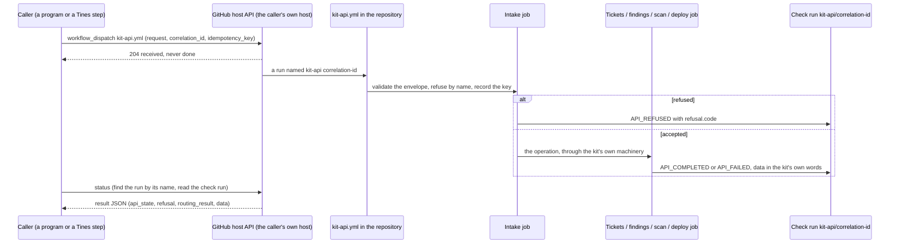
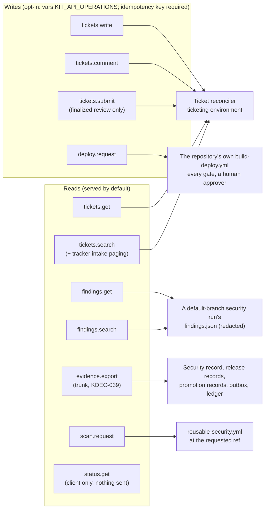

# ARCH-04 · The kit API surface

```
Truth State:  drawn 2026-11-06 from the files cited below, on the trunk. Release 4 (main 10ffcea)
              serves every operation here EXCEPT evidence.export (KDEC-039, trunk only).
Status:       PROPOSED (KDEC-035). Built and proven locally; no hosted or live armed call yet.
Contract:     docs/api/README.md and api/v1/ (the schemas win over any page, this one included)
```

## 1 · One call, end to end



Cited: `scripts/kit_api.py` (client, `OPERATIONS`), `templates/kit-api.yml` (the caller in a
repository), `.github/workflows/reusable-kit-api.yml` (jobs `intake`, `tickets`, `finish`),
`.github/actions/kit-api`, `scripts/kit_api_server.py`, `api/v1/request.schema.json`,
`api/v1/result.schema.json`, `api/v1/refusals.json`.

## 2 · The operations and what each reaches



Cited: `scripts/kit_api.py` `OPERATIONS` (write flags and jobs), `api/v1/params/*.schema.json`
(one schema per operation), `templates/kit-api.yml` (jobs `api`, `scan`, `deploy`, `finish`).

- **No server to host.** GitHub is the transport, queue, access control and audit trail.
- **The API never removes a gate.** A release is the repository's own `build-deploy.yml`, called;
  an agent's release always waits for a person (`API_DEPLOY_NEEDS_HUMAN_APPROVAL`); rollback and
  break-glass are refused (`API_RELEASE_PATH_NOT_PERMITTED`).
- **Least privilege for the caller**: Actions read and write, Checks read, this repository only.
  The run holds its own job token (`contents: read`, `actions: read`, `checks: write`,
  `pull-requests: read`, and on the trunk `deployments: read` for `evidence.export`) and, only in
  the tickets job, the tracker credential from the protected environment.
- **Migration**: a repository that moves its kit pin past KDEC-039 must add `deployments: read`
  to its `kit-api.yml` first, or every call fails at startup (`docs/api/README.md` section 3 item 7).

## 3 · What is proven

`tests/prove_kit_api_client.py` (K1..K9), `tests/prove_kit_api_server.py` (S1..S8),
`tests/prove_kit_api_workflow.py` (W1..W8), `tests/prove_ticket_templates.py`,
`tests/prove_ticket_intake_v2.py`, on the trunk `tests/prove_evidence_export.py`; the self-test job
`kit-api-refuses-by-name` on every hosted self-test. Owed: a hosted armed call per operation.
