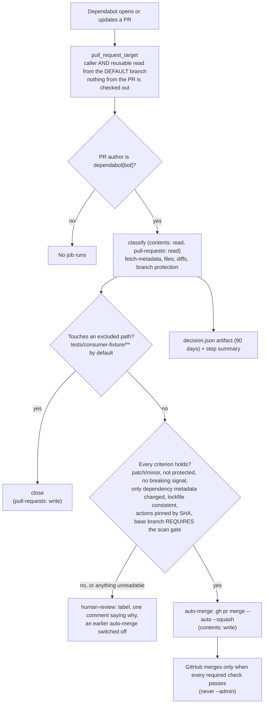
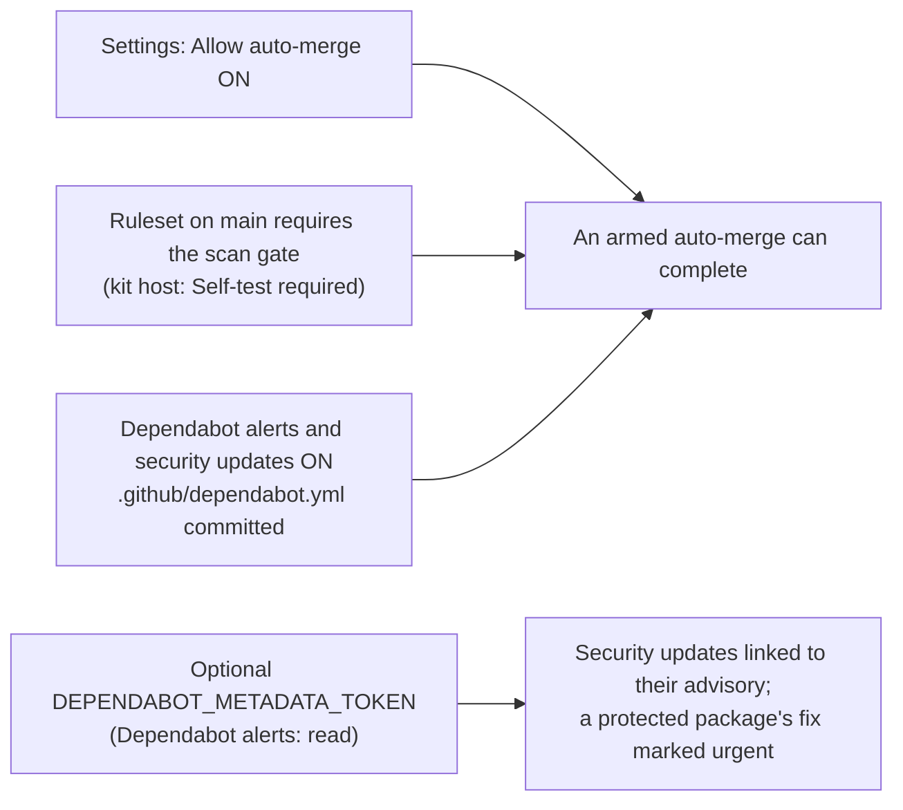

# ARCH-05 · The Dependabot triage

```
Truth State:  drawn 2026-11-06 from the files cited below. The same on the trunk and in
              Release 4 (main 10ffcea).
Audience:     whoever turns on auto-merge for Dependabot, and whoever reviews what merged unseen
Guide:        docs/adoption/DEPENDABOT_TRIAGE.md (the rules, criterion by criterion)
```

## 1 · One decision per Dependabot pull request



Cited: `.github/workflows/reusable-dependabot-triage.yml` (jobs `classify`, `auto-merge`,
`human-review`, `close`), `templates/dependabot-triage.yml` (the consumer's caller),
`.github/workflows/dependabot-triage.yml` (the kit host's own caller, `required_checks:
"Self-test required"`), `.github/dependabot.yml`.

## 2 · What has to be true in the repository settings



- Without "Allow auto-merge" the auto-merge job comments on the PR and nothing merges.
- Without the scan gate as a **required** check every PR is `human_review` / `scan_gate_not_required`
  (fail closed).
- The vulnerability and malicious-package criteria are **delegated to the security gate**; they hold
  only because the gate is a required check.
- **Not established**: the provenance or signature of the new package version
  (`provenance: not_established` on every decision). Not yet run on GitHub (the hosted plan is in the
  guide, section 6).

Proof: `tests/prove_dependabot_triage.py` (D1..D8), `tests/prove_kit_dependabot_triage_caller.py`
(K1..K3), `tests/prove_dependabot_bump_mergeable.py`, `tests/check_action_pins.py` P6..P8.
