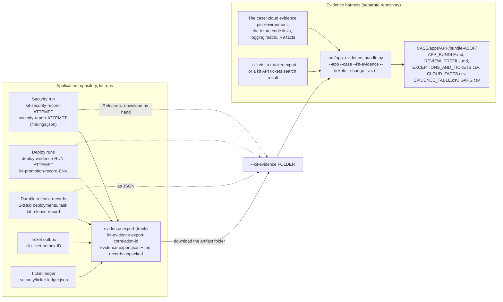

# ARCH-06 · The kit's evidence, into the evidence harness's per-app bundle

```
Truth State:  drawn 2026-11-06 from the files cited below, on the trunk. Release 4 (main 10ffcea)
              keeps every artifact drawn here EXCEPT the evidence.export answer and its
              kit-evidence-export artifact (KDEC-039, trunk only); with Release 4 the reviewer
              downloads the artifacts by hand into one folder instead.
Audience:     the security reviewer of one application's change or adoption
Boundary:     the evidence harness is a separate repository. This page names its entry point
              (src/app_evidence_bundle.py, --kit-evidence) and nothing more of it.
```

## 1 · What the kit keeps, and how it reaches the bundle



Cited (kit): `.github/workflows/reusable-security.yml` (the security record and report artifacts),
`.github/workflows/reusable-deploy-containerapp.yml` ("Write the promotion record", "Reviewer signals
after the release -- the tier's reality and the durable release record", "Keep the run record"),
`.github/workflows/reusable-kit-api.yml` (artifact `kit-evidence-export-...`), `scripts/kit_api_server.py`
(`evidence.export`), `api/v1/evidence-export.schema.json` (`kit-evidence-export/1`), `docs/api/README.md`
section 7.5a. Cited (harness, by name only): `src/app_evidence_bundle.py` and its arguments.

## 2 · The rules the export keeps

- **Every section is ESTABLISHED with its source, or NOT ESTABLISHED with why** -- never an empty list
  standing in for a record nobody could read. KEV is never `false` when the catalog was unreadable.
- **One repository**: a record naming another repository is counted, never copied.
- **No free text, no secret-shaped value, no email**: records are copied through an allowlist of their
  schema's fields; the author is the harness's pseudonym `person:<10 hex>`.
- **The same reads give the same bytes**; `data.export_sha256` binds the whole.
- **Release records outlive artifacts**: the durable deployment record survives artifact expiry
  (evidence retention is floored at 90 days, `KIT_EVIDENCE_RETENTION_DAYS`).
- **The qualifiers travel verbatim, never stronger** (lanes xprod / xprod2, 2026-11-09; risks R-45): each
  finding's `disposition_basis` (`durable`, `legacy`, `legacy-closed`, `DISPOSITION_CARRIED_BY_LINEAGE`,
  `lineage-refused`, `LINEAGE_RECONCILIATION_UNRESOLVED`, or ''); each promotion record's `predecessor.gate` and
  `predecessor.overridden[].code` with `environment.target_resource_id`; the durable release record's promotion
  summary `gate` / `overridden` / `target_resource_id` (codes only, never the free-text why or by).
- **The EVALUATED decision, not the register's raw status** (R-45 M5, KDEC-048, 2026-11-10): each finding with
  a register decision carries `disposition_decision` (schema `kit-disposition-decision/1`), written into
  findings.json by `scan_report.evaluated_decision()` at the run's date from the kit's own evaluator:
  `basis`, `recorded_decision` {`disposition_type`, `state`, `recorded_on`}, `effective_decision`
  (`APPROVED_EFFECTIVE` / `NOT_EFFECTIVE` / `PENDING_REAFFIRMATION` / `PENDING_DECISION`), `finding_cleared`
  (always false), `scope`, `expires`, `separation_of_duties` (`NOT_ESTABLISHED`: the register names a role, not
  people), `source_register` {`register`, `key`}, `evaluated_on`, `reason`. A carried decision is
  PENDING_REAFFIRMATION whatever its predecessor's status. The exporter only checks shape and consistency
  (`decision_of`); a malformed or self-contradictory object is exported `DECISION_NOT_ESTABLISHED` with the
  reason; a report that predates the object exports none, and the reader keeps "not exported".
  `api/v1/evidence-export.schema.json` describes the object (optional, closed to other properties; the six
  properties of the DECISION_NOT_ESTABLISHED form required, the other five in the evaluated form; text fields a
  string or null, `reason` at most 300 characters). It fixes the shape, not two values: `schema` and
  `finding_cleared` are checked by the exporter and again by the reader, so a tampered value is a per-finding
  refusal and never the loss of the whole export. The harness vendors this file by sha256 and must be re-vendored
  whenever it changes.
- **What the harness makes of them** (harness HDEC-XPROD, HDEC-XPROD2; read by name only): every kit finding
  row of `EXCEPTIONS_AND_TICKETS.csv` carries `DispositionBasis`, `ApprovalStatus`, `ReaffirmationRequired`,
  `ReconciliationState` (a carried approval reads `..._NOT_AN_APPROVAL`); each promotion has
  `record_integrity_state`, `promotion_decision_state`, `promotion_decision_basis`, `target_identity_state`
  (`TARGET_UNKNOWN` without a target) and `history_completeness_state`, kept apart; a loose record that
  differs from the export only in a qualifier is `KIT_EXPORT_QUALIFIER_CONFLICT`, never a silent choice.
  Harness HDEC-017 / HDEC-018 (2026-11-10): `record_integrity_state` is `INTEGRITY_NOT_VERIFIED` until a digest
  is verified (two present fields read `record_required_fields_present`), and `ApprovalStatus` reads
  `APPROVED_EFFECTIVE` only where the exported `effective_decision` says so.

## 3 · What is proven

Kit: `tests/prove_evidence_export.py` (trunk; E1..E5, N1..N4, M1..M4, including a bundle built by
the harness from the export; Q1-Q3, QN, M6-M8 and QE3, which with `EVIDENCE_HARNESS_SRC` set reads the
harness's F12 columns, F13 promotion facts and F16 agreement on the unpacked folder; D1-D4, DN1-DN2,
M9-M12 and QE4 for the evaluated decision). Harness: its own
`tests/check_app_evidence_bundle.py`, fixtures only.
Owed: an `evidence.export` from a real repository fed to the harness on a real case.
