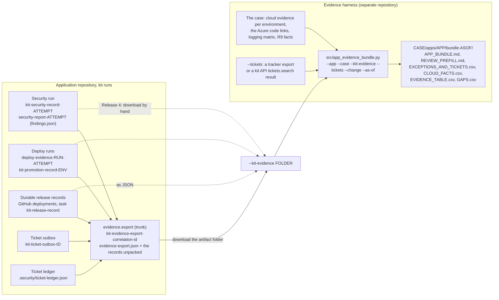

# ARCH-06 · The kit's evidence, into the evidence harness's per-app bundle

```
Truth State:  drawn 2026-11-06 from the files cited below, on the trunk. Release 4 (main 10ffcea)
              keeps every artifact drawn here EXCEPT the evidence.export answer and its
              kit-evidence-export artifact (KDEC-039, trunk only); with Release 4 the reviewer
              downloads the artifacts by hand into one folder instead.
Audience:     the security reviewer of one application's change or adoption
Boundary:     the evidence harness is a separate repository. This page names its entry point
              (src/app_evidence_bundle.py, --kit-evidence) and nothing more of it.
```

## 1 · What the kit keeps, and how it reaches the bundle



Cited (kit): `.github/workflows/reusable-security.yml` (the security record and report artifacts),
`.github/workflows/reusable-deploy-containerapp.yml` ("Write the promotion record", "Reviewer signals
after the release -- the tier's reality and the durable release record", "Keep the run record"),
`.github/workflows/reusable-kit-api.yml` (artifact `kit-evidence-export-...`), `scripts/kit_api_server.py`
(`evidence.export`), `api/v1/evidence-export.schema.json` (`kit-evidence-export/1`), `docs/api/README.md`
section 7.5a. Cited (harness, by name only): `src/app_evidence_bundle.py` and its arguments.

## 2 · The rules the export keeps

- **Every section is ESTABLISHED with its source, or NOT ESTABLISHED with why** -- never an empty list
  standing in for a record nobody could read. KEV is never `false` when the catalog was unreadable.
- **One repository**: a record naming another repository is counted, never copied.
- **No free text, no secret-shaped value, no email**: records are copied through an allowlist of their
  schema's fields; the author is the harness's pseudonym `person:<10 hex>`.
- **The same reads give the same bytes**; `data.export_sha256` binds the whole.
- **Release records outlive artifacts**: the durable deployment record survives artifact expiry
  (evidence retention is floored at 90 days, `KIT_EVIDENCE_RETENTION_DAYS`).

## 3 · What is proven

Kit: `tests/prove_evidence_export.py` (trunk; E1..E5, N1..N4, M1..M4, including a bundle built by
the harness from the export). Harness: its own `tests/check_app_evidence_bundle.py`, fixtures only.
Owed: an `evidence.export` from a real repository fed to the harness on a real case.
