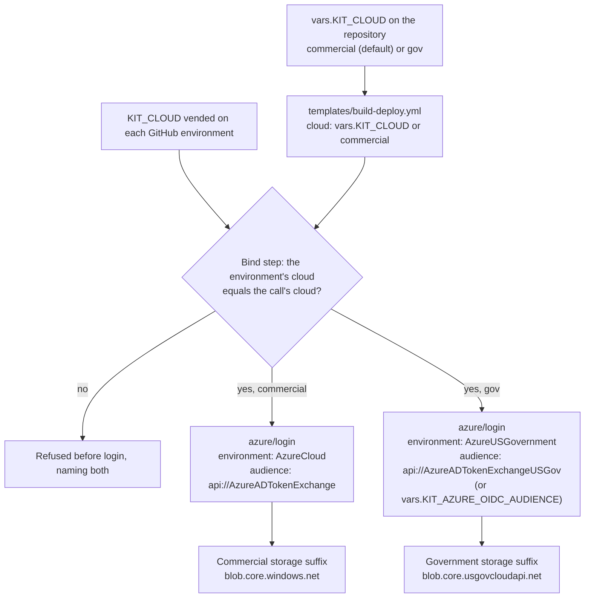

# ARCH-07 · Commercial Azure and Azure Government

```
Truth State:  drawn 2026-11-06 from the files cited below. The same on the trunk and in
              Release 4 (main 10ffcea).
UNVERIFIED:   a live Azure Government sign-in has not run. What is proven is what each step asks
              for; that a Government tenant accepts it is owed to a Government sandbox run.
Estate:       a case configuration, not a fixed shape. Today one organisation may hold several
              commercial tenants and one Government tenant; each repository deploys to ONE cloud.
```

## 1 · One switch per repository, bound by each environment



Cited: `templates/build-deploy.yml` (`cloud: ${{ vars.KIT_CLOUD || 'commercial' }}` on the build and
every deploy job), `.github/workflows/reusable-deploy-containerapp.yml` ("Bind the tier and target to
the GitHub environment", which compares the environment's vended cloud; the Azure login step's `environment` and `audience`;
the storage suffix table), `.github/actions/azure-login-oidc/action.yml` (inputs `cloud`, `audience`),
`tests/prove_azure_gov_audience.py`, `docs/adoption/SETUP.md` section 4.2.

## 2 · What differs, side by side

| | commercial | Government |
|---|---|---|
| `KIT_CLOUD` | `commercial` (or unset) | `gov` |
| `azure/login` environment | `AzureCloud` | `AzureUSGovernment` |
| federated credential audience | `api://AzureADTokenExchange` | `api://AzureADTokenExchangeUSGov`; a credential made with the global audience: set `KIT_AZURE_OIDC_AUDIENCE=api://AzureADTokenExchange` (gov only) |
| federated credential issuer and subject | the GitHub host's issuer; `repo:<org>/<repo>:environment:<env>` | the same: the issuer is the GitHub host's, not the cloud's |
| storage suffix the kit builds (lease, release record) | `blob.core.windows.net` | `blob.core.usgovcloudapi.net` |
| registry login server | `KIT_ACR_LOGIN_SERVER` as vended (the kit builds no registry host name) | the same: `KIT_ACR_LOGIN_SERVER` as vended |

- **The audience is the only federated-credential field that changes**; the subject never names
  the cloud, and the issuer is always the GitHub host's (ARCH-02).
- **One repository, one cloud.** The template passes the repository's one `KIT_CLOUD` to the build
  and every deploy job (a job that calls a reusable workflow reads repository and organisation
  variables, not an environment's); the bind step then refuses a call whose cloud disagrees with the
  value the environment was vended.
- **`verify-azure-oidc.yml` signs in to commercial Azure only** at this trunk (its `azure/login` passes no
  environment or audience): a Government identity is verified by hand until it gains a cloud input.
- **The evidence harness** reads a Government tenant with its own sign-in (`AzureUSGovernment`,
  Graph `USGov`); that is the harness's side and is not drawn here.
