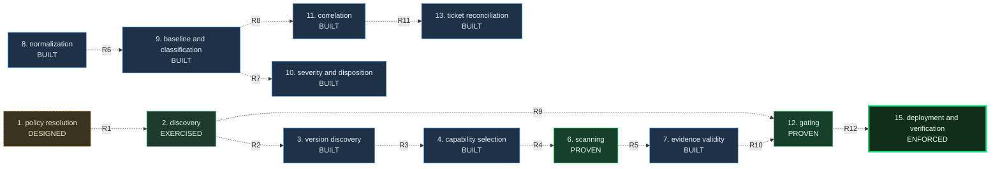

# Pipeline overlays — generated

```
GENERATED by tests/build_pipeline_overlays.py. Do not edit.
Source of truth: the stage register and guardrails in tests/check_stage_phase.py,
and the threat ids in docs/architecture/THREAT_MODEL.md.
Edit those; this file is a projection and has no content of its own.
```

> **A diagram cannot establish that a pipeline works.** This draws declared structure and declared maturity. A stage shown as BUILT is a claim inherited from the register, not an observation of a run. What it is good for is showing where a chain breaks.

## 1 · Stages, by the phase each has actually reached

```mermaid
flowchart TD
  S01["1. policy resolution<br/><b>DESIGNED</b>"]
  S02["2. discovery<br/><b>EXERCISED</b>"]
  S03["3. version discovery<br/><b>BUILT</b>"]
  S04["4. capability selection<br/><b>BUILT</b>"]
  S05["5. execution planning<br/><b>DESIGNED</b>"]
  S06["6. scanning<br/><b>PROVEN</b>"]
  S07["7. evidence validity<br/><b>BUILT</b>"]
  S08["8. normalization<br/><b>BUILT</b>"]
  S09["9. baseline and classification<br/><b>BUILT</b>"]
  S10["10. severity and disposition<br/><b>BUILT</b>"]
  S11["11. correlation<br/><b>BUILT</b>"]
  S12["12. gating<br/><b>PROVEN</b>"]
  S13["13. ticket reconciliation<br/><b>BUILT</b>"]
  S14["14. reporting<br/><b>BUILT</b>"]
  S15["15. deployment and verification<br/><b>ENFORCED</b>"]
  S01 --> S02
  S02 --> S03
  S03 --> S04
  S04 --> S05
  S05 --> S06
  S06 --> S07
  S07 --> S08
  S08 --> S09
  S09 --> S10
  S10 --> S11
  S11 --> S12
  S12 --> S13
  S13 --> S14
  S14 --> S15
  classDef absent    fill:#2b2b2b,stroke:#777,color:#ddd,stroke-dasharray:4 3
  classDef designed  fill:#3a3320,stroke:#b8860b,color:#f0e6c8,stroke-dasharray:4 3
  classDef built     fill:#1f3147,stroke:#4a90d9,color:#e6f0fa
  classDef exercised fill:#1f3a2e,stroke:#3fa37a,color:#e6faf0
  classDef proven    fill:#17402a,stroke:#2ecc71,color:#eafff2
  classDef enforced  fill:#102e1a,stroke:#00e676,color:#f0fff5,stroke-width:3px
  class S01 designed
  class S02 exercised
  class S03 built
  class S04 built
  class S05 designed
  class S06 proven
  class S07 built
  class S08 built
  class S09 built
  class S10 built
  class S11 built
  class S12 proven
  class S13 built
  class S14 built
  class S15 enforced
```



  **ABSENT** 0 · **DESIGNED** 2 · **BUILT** 9 · **EXERCISED** 1 · **PROVEN** 2 · **ENFORCED** 1


## 2 · Guardrails — the boundaries, and what each must refuse



| | upstream | downstream | the boundary must refuse |
|---|---|---|---|
| R1 | 1 policy resolution | 2 discovery | discovery must not accept a narrowed scope from a policy nobody registered -- stage 1 is not on a running path, so every scope today is the default one, and a future policy that quietly excludes a root would be indistinguishable from a root that is not there |
| R2 | 2 discovery | 3 version discovery | version discovery must not report a version for a class discovery did not establish as present, and must not read a manifest it could not parse as a manifest that was absent -- unreadable is its own sentinel |
| R3 | 3 version discovery | 4 capability selection | capability selection must not answer SCANNER_SUPPORTS for a target that was not discovered, or for a constraint that merely overlaps the declared range -- undetermined is a gap, and assume-supported is the one forbidden answer |
| R4 | 4 capability selection | 6 scanning | a scanner must not run as coverage for a version its capability table does not claim |
| R5 | 6 scanning | 7 evidence validity | evidence validity must not read a scanner that failed to acquire as a scanner that found nothing |
| R6 | 8 normalization | 9 baseline and classification | classification must not assign identity across inconsistently rooted paths. One scanner reports scope-relative URIs where two others report repo-relative, so the same file arrives under two identities and one finding becomes two -- a live defect, open in FUTURE_WORK, and exactly the join this boundary owns |
| R7 | 9 baseline and classification | 10 severity and disposition | a disposition may not be inherited by a finding whose identity was not matched, because the approval was given for something else |
| R8 | 9 baseline and classification | 11 correlation | correlation must not cluster on an identity that resets on upgrade, or it groups yesterday's findings under today's key |
| R9 | 2 discovery | 12 gating | gating must not emit PASS when discovery failed -- skipped scanners project to NOT_APPLICABLE, and NOT_APPLICABLE over unscanned code is the collapse this kit exists to refuse |
| R10 | 7 evidence validity | 12 gating | gating must not emit PASS while evidence validity is PARTIAL -- a posture asserted over reports that may have come from tools that read nothing |
| R11 | 11 correlation | 13 ticket reconciliation | no ticket may be created from an unanchored cluster -- one cluster is one obligation is at most one ticket |
| R12 | 12 gating | 15 deployment and verification | deployment must not proceed on a gate verdict that was never emitted as an output |

## 3 · Artifact identity — the chain, and where it stops

```mermaid
flowchart LR
  P1["repo / ref / commit<br/><b>BUILT</b>"]
  P2["build run<br/><b>BUILT</b>"]
  P1 --> P2
  P3["artifact digest<br/><b>DESIGNED</b>"]
  P2 --> P3
  P4["scan + SBOM of THOSE bytes<br/><b>DESIGNED</b>"]
  P3 --> P4
  P5["provenance attestation<br/><b>DESIGNED</b>"]
  P4 --> P5
  P6["registry digest<br/><b>DESIGNED</b>"]
  P5 --> P6
  P7["deployment target<br/><b>DESIGNED</b>"]
  P6 --> P7
  P8["observed running version<br/><b>ABSENT</b>"]
  P7 --> P8
  classDef absent    fill:#2b2b2b,stroke:#777,color:#ddd,stroke-dasharray:4 3
  classDef designed  fill:#3a3320,stroke:#b8860b,color:#f0e6c8,stroke-dasharray:4 3
  classDef built     fill:#1f3147,stroke:#4a90d9,color:#e6f0fa
  classDef exercised fill:#1f3a2e,stroke:#3fa37a,color:#e6faf0
  classDef proven    fill:#17402a,stroke:#2ecc71,color:#eafff2
  classDef enforced  fill:#102e1a,stroke:#00e676,color:#f0fff5,stroke-width:3px
  class P1 built
  class P2 built
  class P3 designed
  class P4 designed
  class P5 designed
  class P6 designed
  class P7 designed
  class P8 absent
```



The chain is specified in `PROVENANCE_AND_ATTESTATION.md` §3 and implemented as far as the build. **Observed running version is ABSENT**, so nothing currently compares the digest that was scanned against the digest that is serving traffic — which is the comparison the whole chain exists to make.

## 4 · Threats, by where they enter

16 threats are registered. Entry point, consequence, control state, test and residual risk for each are in `THREAT_MODEL.md` — not restated here, because a projection that paraphrases its source is a second source.

| id | threat |
|---|---|
| T-01 | Untrusted pull request executes with repository privilege |
| T-02 | Input injection into a shell step |
| T-03 | Token scope exceeds the job's need |
| T-04 | A scanner silently acquires nothing and the job reports success |
| T-05 | A scanner runs but cannot parse what it was given |
| T-06 | Rule-set or advisory drift |
| T-07 | Artifact substitution between scan and deploy |
| T-08 | Provenance asserted rather than verified |
| T-09 | Federated identity usable from outside its intended scope |
| T-10 | Publication failure rewriting the detection verdict |
| T-11 | Sensitive content leaving in the evidence |
| T-12 | Telemetry or evidence tampering |
| T-13 | Shared-resource mutation beyond the release's ownership |
| T-14 | Unsafe rollback |
| T-15 | Approval bypass through the gate's own vocabulary |
| T-16 | Disposition inherited by the wrong finding |

## 5 · How to read the colours

| phase | means |
|---|---|
| ABSENT | nothing exists |
| DESIGNED | a document specifies it. Intent, nothing more. |
| BUILT | code exists on a path something runs |
| EXERCISED | it has run — a run id against a named commit |
| PROVEN | it produced the right answer on seeded input, attributed to itself |
| ENFORCED | it refused a real prohibited operation, and the refusal was recorded |

Dashed borders are ABSENT and DESIGNED: **not progress.** Nothing is drawn as finished, because nothing is.

